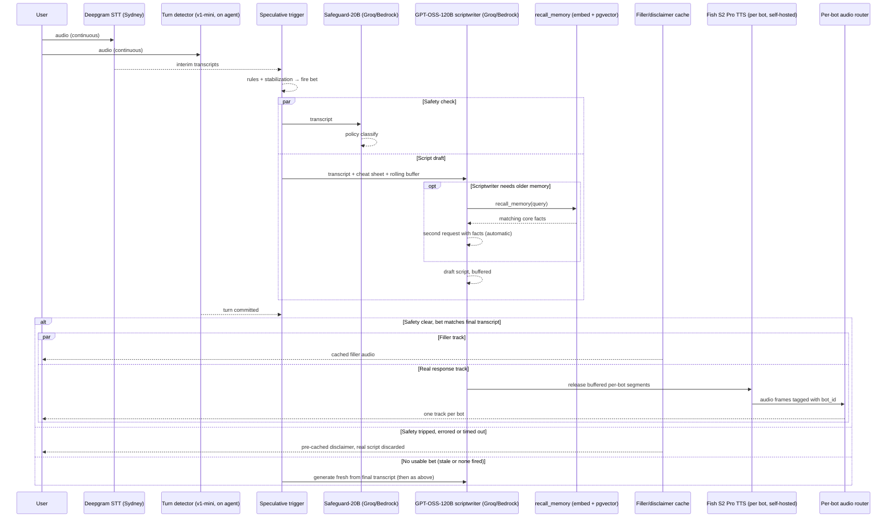

# Voice Companion Architecture v2 — Full Pipeline

Sep 22, 2026 · @Someone — revised Sep 29, 2026

## Bottom line

The v2 architecture — with the safety guardrail and tiered memory added — still clears both targets, with the same caveat as before: **cost has real margin (\~1.2¢/min, well under 3¢), latency does not.** Sub-300ms is achievable on *first audible bot sound* only if the safety check runs genuinely in parallel with a speculative script draft that starts before turn-detection commits, and only with the cached-filler technique still doing the heavy lifting. Long-term memory is kept **off the critical path** entirely: a profile cheat sheet is preloaded at call start, and anything beyond it is fetched on demand by the scriptwriter through a tool call (see Memory). Four specific numbers in the original brief — <15ms for the safety pass, sub-30ms LiveKit edge transit, <50ms Groq inference under a 1,500-token budget, and a speculative bet firing \~130ms *before* the user stops speaking — are optimistic as stated; see Engineering flags for the corrected versions. None of these are fatal, but the brief's own numbers would fail if taken literally.

**Group size:** the user picks 1 or 2 bots from a predefined roster via a room-setup UI before starting the call — group size is user-chosen, not fixed. A user + 1 bot (1-to-1) is a supported, intentional mode; 2 bots is the max for regular users. **Admin users (developers) may add any number of bots for testing.** The pipeline is written generically over N bots — nothing is hardcoded to 2. Room size barely changes cost: the scriptwriter only ever has 1 bot speak per turn (2 during a banter interruption), so TTS, output tokens, parallel TTS streams and LiveKit usage (all bots are tracks on one agent participant) don't grow with N. What does grow is the scriptwriter's **input prompt** — every bot's persona and per-bot cheat sheet go into every call — adding input tokens and prefill time per extra bot, and giving the LLM more personas to juggle. Token budgets in this doc are sized for 2 bots; N > 2 (admin testing) will run slightly over them. The 2-bot limit for regular users is enforced in the frontend (UI and server-side before dispatch) and re-checked by the backend at session start against the user's role.

**In-region target:** every component on the latency-critical path runs in Australia — STT, turn detection, both LLMs, memory and embeddings — **except TTS**: the chosen voice, Fish Audio S2.1, is only available as a hosted API served from the US and Tokyo (see Voice (TTS)). The LLM host was chosen by measurement from Australia (see Engineering flags → "In-region isn't automatically fastest").

## Full stack

| # | Layer | Pick | Role |
| --- | --- | --- | --- |
| 1 | Frontend | Next.js on Vercel Free/Hobby | Login + room-setup UI + server-side dispatch call; drops out once WebRTC connects — zero cost, not on the latency path |
| 2 | Transport + VAD | LiveKit Cloud, Australia region (`aus`) — **pinning requires a paid plan, see Engineering flags** | WebRTC media routing; region-pinning keeps audio transit in-country |
| 3 | Orchestration | Self-hosted LiveKit Agents (Python) on a persistent server in AWS ap-southeast-2 (Sydney) | Runs the whole turn loop next to the media edge — no trans-Pacific hop for orchestration logic |
| 4 | STT | Deepgram Nova-3 on the Australian endpoint (`api.au.deepgram.com`) | Streaming transcription; inference and storage in AWS Sydney. Emits *preflight* transcripts (see Turn-taking). Replaced Inworld STT, which has no Australian endpoint (Inworld stays an optional preset) |
| 5 | Turn detection | LiveKit Turn Detector **v1-mini**, running on the agent (Sydney), selectable per call | Decides when the user's turn has actually ended (turn commit). The full v1 model is only available to agents hosted on LiveKit Cloud, which has no Australian agent region; see Turn-taking |
| 6 | Safety guardrail | GPT-OSS-Safeguard-20B on **Groq (Sydney)**, with **Amazon Bedrock (Sydney)** as automatic fallback | Policy classifier on the live transcript; intercepts self-harm/medical-advice requests before they reach TTS |
| 7 | Memory — Tier 1 (hot) | Redis (Upstash), Sydney | Session state, room boundaries, the **profile cheat sheet** loaded at call start; read every turn |
| 8 | Memory — Tier 2 (long-term) | Supabase Postgres + pgvector, Sydney | Atomic core facts + session summaries; searched on demand via the scriptwriter's `recall_memory` tool — never on every turn |
| 9 | Memory — Tier 3 (rolling) | In-payload short-term buffer, 10–15 messages | Injected directly into the prompt, pruned to protect the token ceiling |
| 10 | Scriptwriter LLM | **GPT-OSS-120B** on **Groq (Sydney)**, with **Amazon Bedrock (Sydney)** as automatic fallback; Harmony format, low reasoning effort (reasoning always on) | Single pass: decides which bot(s) speak (the "conductor" role — originally planned as a separate LLM, merged into this one), writes dialogue + non-verbal tags, holds every persona at once; may call `recall_memory` |
| 11 | TTS | Fish Audio **S2.1, hosted API** — served from the US/Tokyo, the one hot-path component outside Australia; self-hosting parked (see Voice (TTS)) | Streaming synthesis, one stream per speaking bot with that bot's voice; expressive delivery (emotion and non-verbal cues) driven by the scriptwriter's markup |
| 12 | Embedding model | Self-hosted Hugging Face sentence-embedding model on the orchestration server — **specific model TBD after a CPU latency test** | Turns text into vectors for pgvector, both when storing memories and when searching them. No network hop, nothing leaves Australia |
| 13 | Memory extraction LLM | Cheap LLM, **model TBD** | Post-call job: extracts atomic core facts + a session summary from each call's transcript. Off the hot path |

One structural note carried over from the sub-400ms design and still true here: **STT and turn-detection are continuous streams, not a step that starts after the user stops talking** — everything downstream reacts to those streams, it doesn't wait for a full transcript to be handed over.

## Design requirement: pluggable providers

Every external endpoint in this stack — STT, TTS, LLM (including the safety model), plus the turn detector and the speculative-trigger strategy — must be swappable without a code rewrite. Testing provider combinations (e.g. Groq vs Bedrock for the LLMs, or several TTS voices) is an ongoing part of building this, not a one-time choice made once and hardcoded.

Concretely: a config-driven provider registry maps preset names (e.g. `deepgram_nova3_au`, `fish_s21_hosted`, `groq_gptoss120b`) to the actual LiveKit plugin instantiation (auth, model, region params). A Next.js test UI exposes this as dropdowns, resolved server-side (API keys never reach the browser) into preset names, sent to the LiveKit agent worker via **agent-dispatch metadata** at session start (LiveKit's `createDispatch(...)`, read back via `ctx.job.metadata` in the Python entrypoint). This is per-session, not mid-call: picking a combo starts a new test call, it doesn't hot-swap providers inside one already running (the one exception is the automatic Groq → Bedrock fallback for a single failed LLM request, described below).

**Per-call selectable presets:**

| Dropdown | Presets | Default |
| --- | --- | --- |
| STT | `deepgram_nova3_au`, `deepgram_flux_au`, `inworld_stt1` | `deepgram_nova3_au` |
| TTS | `fish_s21_hosted`; parked: `fish_s2pro_selfhosted` (see Voice (TTS)) | `fish_s21_hosted` |
| LLM (scriptwriter) | `groq_gptoss120b`, `bedrock_gptoss120b_syd` | `groq_gptoss120b` (falls back to Bedrock automatically) |
| Safety model | `groq_safeguard20b`, `bedrock_safeguard20b_syd` | `groq_safeguard20b` (falls back to Bedrock automatically) |
| Turn detector | `livekit_v1_mini`, `stt_native` | `livekit_v1_mini` |
| Speculative trigger | `auto`, `livekit_preemptive`, `transcript_rules`, `transcript_debounce_only`, `vad_silence` | `auto` |

Preset names are provisional until the registry is implemented; the registry is the source of truth for the final list.

**Compatibility rules** (the backend rejects an invalid combination at session start with a clear error; the frontend greys out invalid options):
- `stt_native` turn detection is only valid with an STT that reports end-of-turn itself (Deepgram Flux, Inworld — not Deepgram Nova-3).
- `auto` speculative trigger resolves by STT: `livekit_preemptive` for STTs whose LiveKit plugin emits *preflight* transcripts (Deepgram — the default — plus AssemblyAI, Soniox, Cartesia), `transcript_rules` otherwise (Inworld). See Turn-taking for why.
- A preset whose credentials aren't configured is rejected at session start with a clear error.
- **Automatic fallback (LLM and safety):** a request to a Groq preset that is rate-limited (HTTP 429), errors (5xx) or exceeds its time budget before the first token is retried once on the equivalent Bedrock Sydney preset, within the same turn. Retrying is safe because nothing has been spoken yet. Every fallback is logged with the reason. (Groq's free tier rate-limits realistic scriptwriter prompts; its paid tier was unavailable when this was measured.)

**Config-only, not per-call:**
- **Embedding model.** Vectors from different models aren't comparable, so every stored memory must be embedded with the same model that searches it. Changing it means re-embedding the whole memory table — a deliberate migration, never a dropdown.
- **Memory extraction LLM.** Runs after the call, not selectable from the test UI.

This is also why the implementation-language split matters: the agent worker (Python, where the plugin ecosystem for these vendors is most complete) owns the registry and the actual provider instantiation; Next.js (TypeScript) owns the dropdown UI, auth-gated, and the dispatch call. No custom RPC between them — LiveKit's own dispatch/room APIs are the only channel. The exact dispatch-metadata shape is in Frontend contract.

## Turn-taking: turn detection vs speculative bets

Two separate mechanisms with two different jobs:

| | Speculative trigger ("the bet") | Turn detection ("the commit") |
| --- | --- | --- |
| Job | Start the safety check and script draft early | Decide the user has really finished; release audio |
| Cost of being wrong | A wasted, discarded Groq call | A bot talks over the user |
| Tuned for | Speed; allowed to be wrong | Accuracy |

### Turn detection

Selectable per call (`turn_detector` preset):

- **`livekit_v1_mini` (default)** — LiveKit's audio-based turn detector, running **locally on the agent's CPU** in Sydney (no network hop). The v1 model family takes raw audio as input, not a transcript: a neural network trained on finished vs. unfinished speech, with a semantic branch (learned to follow word content directly from sound) and an acoustic branch (intonation, rhythm), fused into one end-of-turn probability. It runs once VAD sees ≥0.25s of silence; per-language thresholds turn the probability into a commit. It only uses the STT's detected language to pick the threshold, so it works identically whichever STT is chosen. v1-mini is the quantized/pruned version: "most of v1's accuracy" (no separate figures published). Needs compute-optimized instances (AWS c6i/c7i) to avoid timeouts.
- **`stt_native`** — use the STT's own end-of-turn signal (LiveKit `turn_detection="stt"`). With **Deepgram Flux** it runs in Sydney alongside transcription (whether Flux is served on the Australian endpoint is unverified); LiveKit's benchmark puts Flux at 12.9% false cutoffs at a 300ms budget and 9.9% at 600ms. Inworld's plugin also exposes end-of-turn settings, with no published accuracy figures.
- **Not available: `livekit_v1`** — the full model is served on LiveKit Inference and offered only to agents **hosted on LiveKit Cloud**; self-hosted agents get v1-mini. LiveKit Cloud's agent hosting has no Australian region (US, Frankfurt, Mumbai), so using v1 would move the agent out of Australia. Reference figures from LiveKit's own benchmark: 9.9% false cutoffs at 300ms, 4.5% at 600ms.

Defaults with the audio model: minimum endpointing delay 0.3s, maximum 2.5s — tunable, and worth tuning on real users' speech — some users pause mid-sentence for longer than average.

### Speculative trigger

**Every bet fires on an event** — a transcript update or a silence event — never on a timer, and never as a prediction of the future. Streaming STT sends its current best guess of the sentence several times a second and revises it as it hears more; each trigger strategy is just a rule for which of those updates is worth betting on. When a bet turns out wrong (the user keeps talking), it's cancelled and a new one may fire at the next plausible ending.

Selectable per call (`speculative_trigger` preset):

1. **`vad_silence`** — bet on whatever the transcript says after a fixed silence (e.g. 150ms). Fewest wasted bets, slowest; ignores the words entirely. Kept as a comparison baseline.
2. **`transcript_debounce_only`** — bet when the transcript stops changing for a short window (e.g. 100ms) and the STT's predicted punctuation looks terminal (`.` `?` `!`).
3. **`transcript_rules`** — #2 plus an instant word-rule check first (table below). Blacklist hit: block the bet. Whitelist hit: fire immediately without waiting for the debounce window. Everything else falls through to #2.
4. **`livekit_preemptive`** — LiveKit's built-in `preemptive_generation`. It doesn't inspect words or silence itself; it fires on the STT's events: every *final* transcript segment (any STT), and additionally on *preflight* transcripts (an early "this looks finished" message that only some STT plugins emit — Deepgram, AssemblyAI, Soniox, Cartesia). Built-in cancel/re-bet, capped by `max_retries` (default 3) and `max_speech_duration` (default 10s).
5. **`auto` (default)** — `livekit_preemptive` with preflight-capable STTs (so `livekit_preemptive` with the default Deepgram STT), `transcript_rules` with Inworld. Reason: the Inworld plugin emits no preflight transcripts, and emits its *final* transcript at the same moment it declares end-of-speech (after its own ≥200ms silence rule). With Inworld, `livekit_preemptive` would therefore fire later than our own trigger, which reads Inworld's in-progress interim text.

**`transcript_rules` step by step**, e.g. *"I was just thinking about my sister's coming to visit this weekend, … isn't that nice."* (brief pause after "weekend"):

1. Interim text streams in; each update restarts the stabilization timer.
2. Each update's last word is checked against the rule lists: blacklist → no bet; whitelist → fire now; otherwise → step 3.
3. Text unchanged for the debounce window + terminal punctuation → **fire a bet**.
4. A bet = **safety check + scriptwriter draft, in parallel**, on that exact text. The draft is buffered, never played. (The scriptwriter already has the profile cheat sheet in its prompt; if it calls `recall_memory`, that happens inside the bet — see Memory.)
5. They pause after "weekend" → bet #1 fires. "isn't that nice" arrives → text changed → bet #1 is **cancelled immediately** (Groq stream stopped, so output tokens stop being billed) and the bet counter goes to 1.
6. "…isn't that nice." settles → bet #2 fires. They stay silent.
7. Turn detector commits. If the bet's text matches the final transcript, its draft is used; otherwise it's discarded and a fresh generation starts. Then the safety gate (see sequence diagram).

**Rules for all trigger strategies:**
- **Only one bet in flight.** A new bet always cancels the previous one first.
- **Bet cap: 3 per user turn, plus a 10-second speech cut-off** (both tunable). The counter resets at turn commit. After the cap, no further bets that turn; the reply is generated at turn commit (slower by roughly one LLM first-clause time, covered by the filler).
- **The commit can win the race.** If turn detection commits before any bet has fired (e.g. the STT is slow to deliver the last words), the commit itself triggers generation. No head start that turn; nothing breaks.
- **Metrics per turn**, logged with session/turn id and active presets: bets fired, bets wasted, and time between the used bet firing and turn commit. Defaults get chosen from this data, not guessed.

**Why the cap and rules matter at scale:** a wasted bet costs one scriptwriter call + one safety call (\~$0.00013 for the scriptwriter at the cost model's rates). At \~3 user turns/min and up to 3 wasted bets per turn, that's up to \~0.12¢/min — up to \~10% of the \~1.2¢/min total in the worst case. The goal is the earliest bet with the fewest misses, not the most bets.

| Language | Blacklist (blocks the bet) | Whitelist (fires immediately) |
| --- | --- | --- |
| English | `the`, `a`, `an`, `and`, `but`, `or`, `my`, `your`, `because`, `uh`, `um` — **not** trailing prepositions (`to`, `for`, `with`, `at`, `on`): these are common, grammatical sentence endings in spoken English ("Who's that for?"), blacklisting them would slow down normal speech | Starts with `How`/`What`/`Who`/`Why`/`Are you`/`Can you` + a verb phrase; or ends on a temporal anchor (`today`, `yesterday`, `right now`) or a name (`Paul`, `Gary`) |
| Mandarin | Trailing `的` (de), `和` (he, "and"), `因为` (yinwei, "because") — unfinished connectors/particles | Ends on a sentence-final particle: `了` (le), `吗` (ma), `呢` (ne), `吧` (ba) — these grammatically sit almost exclusively at true clause boundaries, arguably a stronger signal than any English rule |
| Spanish | Trailing bare article (`el`, `la`, `los`, `las`, `un`, `una`); trailing `y` (and), `pero` (but), `porque` (because) | Starts with `¿Qué`, `¿Cómo`, `¿Quién`, `¿Por qué`, or inverted-question form |

**Be honest about what the rule layer buys you:** it only resolves the clear-cut edges of the distribution — obviously-unfinished trailing tokens, and short obviously-complete utterances (greetings, simple questions). Most real conversational sentences are neither blacklisted nor whitelisted and still fall through to the debounce+punctuation baseline, which stays the primary mechanism, not a rare fallback. Treat the rule layer as a cheap accelerant that reduces wasted/wrong bets on the edges, not a replacement for the baseline. The stabilization thresholds were reasoned about against Deepgram's interim-result behaviour; validate them against Deepgram's measured cadence from Sydney, and re-validate for any other STT preset.

## Sequence diagram

The safety check runs **alongside** the speculative script draft, not in front of it. Long-term memory is not in the parallel block: the cheat sheet is already in the prompt, and a Tier 2 lookup only happens if the scriptwriter asks for one. If safety trips, the `alt` branch swaps in a pre-cached disclaimer instead of the real script.



Reading it: the bet starts safety and the script draft the moment the transcript settles, and neither waits for the other. Turn-detection commits on its own clock in parallel. Only once it commits does the `alt` gate fire: safety's verdict decides whether the buffered script or the disclaimer gets released to audio. The safety gate fails closed — an error, timeout or unparseable verdict is treated as "unclear" and plays the disclaimer.

## Latency budget — concrete example

User says: *"Oh you know, I was just thinking about my sister's coming to visit this weekend, isn't that nice."* `T=0` = the user stops speaking.

| Time | Event |
| --- | --- |
| before the call's first turn | Profile cheat sheet loaded from Supabase into Redis/prompt at session start — not per turn |
| throughout utterance | Deepgram STT streams interim and preflight transcripts (cadence from Sydney not yet measured); a bet may fire and be cancelled at the pause after "weekend" |
| T ≈ 0 to +100ms | Last words land in the transcript (depends on STT interim latency); text settles → bet fires: safety + script draft in parallel |
| T ≈ bet + low tens of ms | Safety verdict lands (API round-trip plus a short classification; realistically low tens of ms, not <15ms) |
| T ≈ bet + TTFT + \~2ms/token | Script draft's first clause buffered (GPT-OSS-120B generates \~500 tokens/s on Groq; Bedrock speed to be measured) |
| T ≈ +300ms or later | Turn detector commits (v1-mini: ≥0.25s VAD silence, default minimum endpointing delay 0.3s, tunable) |
| T ≈ turn-commit | Safety verdict already sitting there → `alt` gate fires immediately; cached filler dispatched (0ms compute) **and** buffered script released to TTS, same instant |
| T ≈ turn-commit +20–80ms | Filler audio reaches the user — first-audible-sound, comfortably inside 300ms from turn-commit |
| T ≈ turn-commit + TTS first audio | Real audio streams in behind the filler. Fish's hosted API measured **\~465–520ms** to first audio from Australia (free model, request/response API — the streaming WebSocket API the agent uses is still to be measured). Filler lengths are tuned to cover it |

The earlier version of this table had the bet firing at T ≈ −130ms, i.e. before the user stopped speaking. That isn't achievable: a bet can only contain words the STT has already transcribed, and transcription always trails speech. The head start that matters is bet-to-commit (here roughly 200ms), not bet-to-end-of-speech.

The load-bearing assumption: **the bet fires and the safety verdict lands before turn-detection commits**, so they're free by the time you need them. If the bet is late, the commit triggers generation itself and that turn loses its head start. Turns where the scriptwriter calls `recall_memory` pay extra (one embedding + one pgvector query + a second LLM request, roughly +150–300ms, estimate); if that's still pending at commit, the "thinking" filler covers it (see Memory).

## Memory

### Reading memory during a call

- **Tier 1 — profile cheat sheet (preloaded).** At session start, the backend builds a cheat sheet from Supabase and holds it in Redis for the call: the highest-importance core facts plus the most recent session summaries, filtered per bot to what that bot witnessed (see sharing rules below). It goes into every scriptwriter prompt. Well-engineered, this covers most turns without any lookup.
- **Tier 2 — `recall_memory` tool (on demand).** The scriptwriter is given a `recall_memory(query, other_bot=None)` tool and calls it only when the cheat sheet and rolling buffer don't answer the turn. LiveKit Agents runs the tool and makes the second LLM request automatically; `max_tool_steps=1` limits it to one lookup per turn. The prompt must be firm that the tool is for gaps only; tool-call rate is logged per session so over-calling can be measured and tuned.
  - Lookup = embed the query with the self-hosted embedding model → exact vector search over that user's core facts that the calling bot witnessed (see Database schema).
  - The safety verdict from the first request carries over; safety is not re-run for the tool's second request (the user's words haven't changed).
  - **"Thinking" filler:** if a lookup is still pending at turn commit, a thinking filler plays instead of the normal one ("Hmm, let me think…"). A lookup that finishes inside the bet, before commit, is inaudible.
- **Tier 3 — rolling buffer.** Last 10–15 messages of the current call, injected directly into the prompt.

### Sharing memory between bots

Memories belong to the user but are **scoped to the bots that witnessed them** (were in the room when it was said).

- A bot's cheat sheet and default `recall_memory` searches only include memories that bot witnessed.
- If the user asks a bot about something they only told a different bot, the bot says it doesn't recall and **offers to ask the other bot**: *"I don't recall you mentioning it, but I can ask Jason if you like?"*
- Only after the user agrees does the bot call `recall_memory(query, other_bot="jason")`, and it answers with attribution: *"Jason says it was Luigi's on Crown Street!"* A bot never volunteers another bot's memories unprompted.
- If the other bot is in the same room, the scriptwriter can simply have that bot answer.

### Writing memory: post-call extraction

When a call ends, an async job processes that call's transcript (per session, not per 24 hours — so memories are available minutes later, and every extracted fact inherits the session's set of bots as its witnesses):

1. Load the session's messages and the user's existing related core facts.
2. A cheap LLM extracts **atomic core facts** — standalone sentences about the user (preferences, people, places, health, emotional triggers), including entities mentioned only once — and a **session summary**.
3. Rules for extraction: only facts the **user** stated or confirmed (never bot-invented content); relative dates resolved to absolute dates (`occurred_at`); an **importance** score per fact (drives the cheat sheet); structured JSON output validated against a typed schema, rejected and retried if malformed.
4. For each candidate fact the LLM returns **ADD** (new), **UPDATE** (changes an existing fact — the old one gets `superseded_by`), or **SKIP** (already known), to prevent nightly-style duplication and contradictions.
5. Embed new/updated facts and write them with their witness rows.

The job is idempotent per session id, so a failed run can be retried safely. Where it runs (end-of-call hook in the agent worker vs. a separate job queue) is an implementation choice, to be decided when it's built.

### Embeddings

pgvector stores vectors and finds the nearest ones; it does not create them. The self-hosted embedding model (stack layer 12) turns text into vectors both at write time (extraction job) and at read time (`recall_memory`). One model for all stored vectors; its dimension fixes the column size; each row records which model produced it.

## Database schema (owned by the backend repo)

**Ownership, now that this is split into a frontend and backend repo:** the actual Supabase Postgres schema and its migrations live in and are applied from the **backend** repo (`supabase/migrations/`), even though both repos read/write this database — backend for memory and transcripts, frontend for user accounts, room/session history, and anything else user-facing. One schema, one place migrations are written and applied, so two independently-edited repos don't drift apart on what the tables actually look like.

The frontend repo consumes the schema through Supabase's generated TypeScript types (`supabase gen types typescript`), regenerated after any schema change — never hand-typed to match an assumption about what a table looks like. If frontend work surfaces a need for a new table or column, the shape gets drafted and added as a migration in the backend repo, then frontend's types get regenerated from the live schema.

### Naming convention

**Every table and column is snake_case**, with no exceptions for third-party libraries. Application code may use other conventions (e.g. camelCase in TypeScript) only through its own mapping layer.

**Names are product-neutral:** tables, columns, enum values and seed data describe the generic product (the person in a call is a `user`), never a specific audience.

### Auth tables — custom Auth.js adapter

Login is handled by **Auth.js in the frontend** (a JavaScript library; the Python backend never uses it — it receives the user's `user_id` in dispatch metadata). Providers: Google + email/password (Credentials), with **JWT sessions** — the same setup as the sports-finder-app.

Auth.js never touches the database itself; it passes camelCase JavaScript objects (`emailVerified`, `providerAccountId`, …) to a **database adapter**. The off-the-shelf adapters (`@auth/pg-adapter`, `@auth/supabase-adapter`) hard-code camelCase column names, and the ORM-based ones (Prisma, Drizzle) would add a second database library to the frontend whose table definitions must be hand-synced with the migrations here. Neither is acceptable, so **the frontend implements a small custom adapter** on `supabase-js`, typed from the generated Supabase types, that maps Auth.js's objects onto these snake_case tables. With JWT sessions and no email-verification flow, it only needs the user and account methods (roughly `createUser`, `getUser`, `getUserByEmail`, `getUserByAccount`, `updateUser`, `linkAccount`); session methods are never called.

Draft (not yet a migration):

```sql
CREATE TYPE user_role AS ENUM ('admin', 'user');

CREATE TABLE users (
    id             uuid        PRIMARY KEY DEFAULT gen_random_uuid(),
    name           text,                          -- nullable: not every OAuth profile provides one
    email          text        NOT NULL UNIQUE,   -- always stored lowercase (CHECK below)
    email_verified timestamptz,                   -- set by Auth.js for OAuth sign-ins
    image          text,
    password_hash  text,                          -- null for Google-only accounts
    role           user_role   NOT NULL DEFAULT 'user',  -- admin: unlimited bots per call (testing)
    created_at     timestamptz NOT NULL DEFAULT now(),
    updated_at     timestamptz NOT NULL DEFAULT now(),   -- maintained by a trigger
    CHECK (email = lower(email))
);

-- One row per OAuth provider login linked to a user (e.g. their Google account).
-- Token columns mirror the OAuth fields Auth.js passes through.
CREATE TABLE accounts (
    id                  uuid    PRIMARY KEY DEFAULT gen_random_uuid(),
    user_id             uuid    NOT NULL REFERENCES users (id) ON DELETE CASCADE,
    type                text    NOT NULL,
    provider            text    NOT NULL,
    provider_account_id text    NOT NULL,
    refresh_token       text,
    access_token        text,
    expires_at          bigint,
    token_type          text,
    scope               text,
    id_token            text,
    session_state       text,
    UNIQUE (provider, provider_account_id)
);
CREATE INDEX accounts_user_id_idx ON accounts (user_id);
```

- **No `sessions` table** — JWT sessions never use it. Add one only if the app moves to database sessions.
- **No `verification_tokens` table** — only needed for email verification or magic-link sign-in; add it with that feature.
- `user_id` is always the end user (the person talking to the bots); every other table's `user_id` references `users (id)`.

**Email case:** emails are stored **lowercase only** — a CHECK constraint rejects anything else, so uniqueness is a plain `UNIQUE` and lookups are simple equality from `supabase-js`. The frontend's Auth.js adapter lowercases emails before every insert and lookup; forgetting to fails loudly (constraint error) rather than creating a duplicate account.

**RLS is mandatory:** Supabase exposes `public` tables through its API, so every table — especially `users` with `password_hash` — has RLS enabled. With Auth.js (not Supabase Auth), Supabase's `auth.uid()` doesn't work out of the box; until user-facing policies are designed, tables are accessed only server-side (frontend with the service-role key, backend over a direct Postgres connection) and RLS denies everything else. Migrations also revoke the default table privileges Supabase grants to its `anon` and `authenticated` API roles, so the browser-facing roles have no access even if a policy is added by mistake.

### How the tables relate

```
users ──1:N── accounts                         (login providers)
  │
  ├──1:N── sessions ──N:M── bots               (via session_bots: which bots were in each call)
  │           │
  │           └──1:N── messages ──N:1── bots   (who said each line: the user, or a bot)
  │
  ├──1:N── memories ──N:M── bots               (via memory_witnesses: which bots heard each memory)
  │           ├── N:1 → sessions               (the call it was learned in)
  │           └── N:1 → memories               (superseded_by: the newer fact that replaced it)
  │
  └──N:M── bots                                 (via user_bot_relationships: how well each bot knows the user)
```

**Delete rules:** deleting a **user** cascades to everything that belongs to them (accounts, sessions, transcripts, relationships, memories) — the right to be forgotten. **Bots** are never deleted while anything refers to them (`ON DELETE RESTRICT`); they're retired with `is_active = false`. Deleting a **session** cascades to its bot list and transcript, but a memory learned in it survives (`session_id` becomes null).

**Same-user guarantee:** tables partitioned by `user_id` reference their parent with `(user_id, id)` pairs rather than `id` alone (e.g. `messages (user_id, session_id) → sessions (user_id, id)`), so the database itself guarantees a transcript line or memory can't be attached to another user's session or memory.

### Calls, bots and transcripts (migration `20260930073542`)

The authoritative definitions are in the migration file; summary:

- **`bots`** — the roster: `slug` (short fixed name, e.g. `gary`), `display_name`, `persona_prompt` (personality text the scriptwriter reads), `ui_description` (room-setup bio), `avatar_url`, `voice_id` (Fish Audio voice reference), `is_active`, timestamps. Referenced by `session_bots`, `messages`, `user_bot_relationships` and `memory_witnesses`.
- **`sessions`** — one row per call: `user_id → users`, `livekit_room_name`, `status` (`active` / `ended` / `failed`, kept consistent with `ended_at`), `end_reason`, one column per chosen preset (`stt_preset`, `tts_preset`, `llm_preset`, `safety_preset`, `turn_detector_preset`, `trigger_preset`), `started_at`, `ended_at`.
- **`session_bots`** — junction table: which bots were in each call (`session_id`, `bot_id`). The source of truth for "who was in the room", copied into `memory_witnesses` by the post-call job.
- **`messages`** — the transcript, one row per spoken line: `session_id`, `seq` (order within the call), `speaker` (`user` / `bot`), `bot_id` (set exactly when a bot spoke), `text` (what was actually **heard**), `interrupted` (bot lines only), `spoken_at`. Hash-partitioned by `user_id` into 16 partitions.
- **`user_bot_relationships`** — one row per (user, bot) pair that has talked: `first_met_at`, `last_call_at`, `call_count`, `rapport_level` (1 = just met … 10 = close friend) and `rapport_notes` (short summary), both maintained by the post-call job. The scriptwriter reads it so each bot treats the user as a new acquaintance or an old friend as appropriate.

**Frontend note:** the room-setup screen reads `bots` (active only) server-side with the service-role key; the browser roles have no access (RLS).

### Draft — memory tables (not yet a migration)

**Written once the embedding model is chosen (task 7.1)**, because the model fixes the vector column's size.

`user_id` is always the end user (the person talking to the bots) and references `users (id)`.

```sql
CREATE TYPE memory_type AS ENUM ('core_fact', 'session_summary');

CREATE TABLE memories (
    id              uuid        NOT NULL DEFAULT gen_random_uuid(),
    user_id         uuid        NOT NULL REFERENCES users (id) ON DELETE CASCADE,
    session_id      uuid,                              -- call it came from (→ sessions, see below)
    type            memory_type NOT NULL,
    memory_text     text        NOT NULL,
    importance      smallint    CHECK (importance BETWEEN 1 AND 10),  -- core facts; drives the cheat sheet
    embedding       halfvec(768),                      -- dimension fixed by the chosen embedding model
    embedding_model text,
    occurred_at     timestamptz,                       -- when the event happened, not when stored
    created_at      timestamptz NOT NULL DEFAULT now(),
    superseded_by   uuid,                              -- set when a later fact replaces this one (→ memories, see below)
    PRIMARY KEY (user_id, id),                         -- partition key must be part of the PK
    CHECK (type <> 'core_fact' OR embedding IS NOT NULL)
) PARTITION BY HASH (user_id);

-- Which bots were present when a memory was said (the sharing rule).
-- A join table rather than an array column so bot_id can be a real foreign key.
CREATE TABLE memory_witnesses (
    user_id   uuid NOT NULL,
    memory_id uuid NOT NULL,
    bot_id    uuid NOT NULL REFERENCES bots (id) ON DELETE RESTRICT,
    PRIMARY KEY (user_id, memory_id, bot_id),
    FOREIGN KEY (user_id, memory_id) REFERENCES memories (user_id, id) ON DELETE CASCADE
);

-- recall_memory: exact search, scoped to one user + one bot
SELECT m.memory_text, m.occurred_at
FROM memories m
JOIN memory_witnesses w ON w.user_id = m.user_id AND w.memory_id = m.id
WHERE m.user_id = $1 AND w.bot_id = $2
  AND m.type = 'core_fact' AND m.superseded_by IS NULL
ORDER BY m.embedding <=> $3
LIMIT 5;
```

Further references in the final migration: `(user_id, session_id) → sessions (user_id, id)` with `ON DELETE SET NULL (session_id)` so a memory outlives its call, and `(user_id, superseded_by) → memories (user_id, id)` so a fact can only be replaced by the same user's fact. Transcripts are in `messages` (above); **raw transcripts are kept indefinitely for now.**

**Indexing and performance decisions:**
- **Exact vector search per user, no HNSW (for now).** pgvector applies `WHERE` filters *after* an HNSW index scan (default `hnsw.ef_search` = 40 candidates), so an HNSW index shared by many users would, for one user, return few or no rows. A single user's history is thousands of rows, not millions, so the primary key's `user_id` prefix narrows to that user's rows and Postgres computes exact distances on them — 100% recall, expected low-single-digit ms (to be benchmarked). HNSW (with pgvector ≥0.8 iterative scans) is only worth revisiting if individual histories grow very large.
- **Hash partitioning by `user_id`** — for maintenance (smaller per-partition indexes, faster vacuum) and cache locality, not for vector-search correctness. Cheap to set up now, expensive to retrofit onto a large live table. Partition count TBD.
- **`halfvec`** — half-precision storage halves table and index size with negligible recall loss.
- **Connection path: Supabase's transaction pooler (Supavisor, port 6543) plus a small client-side pool held open by the agent.** The client-side pool means no lookup pays connection setup; the pooler lets thousands of calls share a small number of real database connections. Direct or session connections don't scale here: Postgres has a hard connection limit, and LiveKit runs each call in its own process, so per-call connections would exhaust it. Transaction pooling can't support prepared statements, so they're disabled in the driver; no session-level Postgres features are needed (anything that must be set is set within a single transaction).

**Row-level security:** every table has RLS on with **no policies** (the browser-facing roles get nothing; server-side access bypasses RLS). User-facing policies are designed if the frontend ever needs direct browser access. Memories and transcripts hold sensitive personal and health information and must never be readable from the browser.

**Future, not now:** delegated access to a user's memories (e.g. by a family member) — an additive access table linking another account to that user; no change to the memory tables.

Once finalized, the schema itself stays documented here, so both repos' copies of this doc stay in sync when it changes.

## Multi-bot audio output

One LLM writes the script for all bots; the backend splits it into per-bot segments, synthesizes each bot's segments with that bot's voice (parallel Inworld TTS streams), and publishes each bot on its own audio track. The browser plays all tracks; overlaps blend naturally.

**Design (pending prototype):** one `AgentSession`, one agent participant, **one audio track per bot**, named `bot:<bot_id>`.

- `AgentSession` keeps the input side and the machinery it provides: STT, turn detection, speculative/preemptive generation, the automatic tool loop, barge-in handling, and fillers. Our scriptwriter replaces its LLM step (`llm_node`).
- Its audio output (`session.output.audio`) is a documented, replaceable component. We replace the default single-track output with a **per-bot router**: our TTS step tags every audio frame with its `bot_id` in the frame's `userdata`, and the router pushes each frame onto that bot's track.
- **Barge-in:** when the user interrupts, the router's clear/stop empties **all** bot tracks at once — including during a banter overlap.
- **Speaking indicator:** LiveKit's built-in active-speaker detection is per *participant*, so it can't tell bots on one participant apart. The router knows exactly when it starts and stops each bot's audio and sends `bot_speaking` data messages (see Frontend contract).
- **Captions (optional):** LiveKit Agents' transcript stream is synchronized to audio playback and can be attributed to a specific track — per-bot captions, useful for accessibility (users with hearing difficulties).
- **Unverified, first thing the prototype checks:** that the `userdata` tag survives every pipeline stage from the TTS step to the output. LiveKit's own source relies on the same mechanism to carry transcript timing, which strongly suggests it does.

This replaces the earlier recommendation of one LiveKit participant per bot: per-bot track names make each bot addressable for the fade and the speaking indicator without a second room connection per bot.

## Bot-to-bot interruption (banter)

Requested: bots should be able to cut each other off mid-sentence the way people do — Gary bragging about tomatoes, Paul barging in with "Hold your horses, young man..." — with both voices audibly overlapping for a beat before Gary's line fades out.

**Correction to the proposed mechanism:** LiveKit's SFU does not mix audio server-side — it "forwards a copy of each track to each subscriber without manipulating the underlying packets." There is no LiveKit "mixer channel" to route into. Two bot tracks subscribed and unmuted at the same time already blend automatically in the listener's browser, for free — that part needs no engineering. What has to be built is everything that controls *when* the overlap starts and *how it ends*.

**The real difficulty is playback-timing sync, not prompt engineering.** The scriptwriter LLM generates text far faster than TTS audio is actually heard (clause-level streaming means the LLM may already be writing clause 3 while the user is still hearing clause 1). An `[INTERRUPT: BOT_NAME]` tag firing at LLM-token time would cut Paul in far too early relative to what's actually audible. The trigger has to be anchored to Gary's **audio playback position**, not his text-generation position.

Three separate layers, only one of which is prompting:

1. **LLM (prompt engineering).** The scriptwriter writes structured per-speaker segments and, for banter, tags where the interrupter cuts in — then simply stops writing the rest of the interrupted bot's line. "How much of Gary's sentence gets said" falls out of content generation for free; no extra tagging of duration needed.
2. **Backend scheduling (new work), and the part that actually owns timing.** Generate both segments' audio essentially immediately in parallel — Gary's segment streams to TTS as normal, and the interrupting bot's line is fully synthesized right away too, then held in a buffer rather than generated cold at the interrupt moment. That decouples TTS-generation speed from the trigger: the only thing that has to happen precisely on time is starting playback of audio that already exists. The backend tracks Gary's actual dispatched-audio duration in real time and, at the computed offset, pushes the buffered interrupt audio directly onto the interrupting bot's track (alongside the per-bot router, which is still streaming Gary). LiveKit itself never decides any of this — it's a blind router that forwards whatever frames it's given, the instant they're pushed, with no awareness that an interruption is happening; all the timing intelligence lives in this backend logic.
3. **The 350ms fade (new work, not a LiveKit feature).** With no server-side mixer, this has to happen client-side: the agent sends a `bot_fade` data message the instant it starts the interrupting bot's audio, and the frontend runs a Web Audio `GainNode` ramp on the interrupted bot's track (`bot:<bot_id>`) down over the fade window. Doing sample-level gain processing inside the Python agent would add real CPU work to the hot path for no benefit over doing it in the browser.

The browser never decides *when* an interruption happens — it only executes the fade the instant it's told to, on a cue the backend sends. All timing intelligence — both segments' pre-generated audio, the trigger moment, and the fade cue — lives in one place: the backend.

**Previously open questions, now resolved:**

- **Barge-in during an overlap.** The per-bot router's stop clears every bot track, so an overlap ducks/stops the same way a single bot does (see Multi-bot audio output).
- **Bot track identity.** One agent participant with one named track per bot (see Multi-bot audio output), pending prototype.

**N > 2 bots (admin testing only):** the scheduler handles one interruption at a time between any two bots; no additional mechanism for larger groups.

**350ms is a starting default, not a validated number.** It should be a tunable parameter, confirmed by ear once real TTS latency and real playback are in the loop — not treated as a spec to hit exactly.

## Voice (TTS)

**Requirements** for a production voice: human-sounding and likeable; at or below Inworld TTS-2 Flash's price (\~$15 per 1M characters ≈ $0.0056 per call-minute), directly or via self-hosting with a commercial licence; runs in Australia; scales to hundreds or thousands of concurrent calls.

**Current choice: Fish Audio S2.1, hosted API.** Pay-as-you-go ($15 per 1M bytes of text ≈ $0.0056–0.0083 per call-minute); the free `s2.1-pro-free` model is available until 30 Nov 2026 but may use requests to improve Fish's models, so **only test conversations go through the free tier** — real users require the paid model. Served from the US and Tokyo: measured **\~465–520ms to first audio** from Australia (request/response API, free model; the WebSocket streaming API and the paid model are still to be measured). S2.1's weights aren't published, so it can't be self-hosted.

**Self-hosting (parked).** Fish S2 Pro (the previous version, downloadable weights under a **non-commercial** research licence) could run in Australia alongside a self-hosted LLM. Attempts and findings, 2026-09-29/30:
- **Modal, Australian region:** no GPU capacity — requests for an L40S, then A100/H100, queued with no container starting (10+ minutes each).
- **Azure Container Apps serverless A100, Australia East:** \~A$12.70/hour (the A100 profile bundles 24 vCPU and 220GB RAM) and an open capacity issue for new A100 replicas (microsoft/azure-container-apps#1844).
- **RunPod Pod, NSW data centre:** a dedicated A100 80GB (\~A$2.30/hour) could host both models. Designed but not built: models on a network volume, a fresh Pod per session, **terminate (not stop) when idle**, with layered shut-off (backend timer, in-Pod idle watchdog, hard lifetime cap, external sweeper, prepaid balance with auto top-up off). **Cold start is 2–5 minutes**, so calls would start on the managed services and switch to the Pod once warm (between turns; the LLM is the same model on both).

Revisit self-hosting when call volume makes a fixed GPU cost worthwhile.

**Candidates evaluated:**

| Option | Human-like | Price | Runs in Australia | Scale | Verdict |
|---|---|---|---|---|---|
| Azure Neural TTS (standard voices), Australia East | Good; styles on some voices; no laughs/sighs | $16/1M chars (commitment tiers as low as \~$7.50/1M) | ✅ | 200 concurrent by default, raisable | **Meets all four** — managed production option |
| Qwen3-TTS (Apache 2.0), self-hosted in Sydney | Strong; emotion via plain-language instructions; voice design from a description | \~$3/1M chars at scale (Baseten's measurement, US hardware) | ✅ (self-hosted) | \~25 streams per H100 | **Meets all four** — self-hosted production option; needs listening test |
| Orpheus 3B (Apache 2.0 + Llama 3.2 licence), self-hosted | Strong; tags `<laugh>` `<sigh>`… | Low at scale | ✅ (self-hosted) | 16–24 streams per half-H100 (Baseten) | Runner-up; English-only in production; "Built with Llama" attribution required |
| Fish S2 Pro, self-hosted | Very strong | Low at scale + commercial licence fee (unpublished) | ✅ (self-hosted) | Serving engine batches requests | **Parked** — non-commercial licence; no GPU capacity found on scale-to-zero platforms in Australia |
| Fish S2.1 (hosted) | Very strong | $15/1M bytes | ❌ US/Tokyo (\~465–520ms first audio measured from Australia) | ✅ | **Current choice** |
| Inworld / Cartesia (hosted) | Very strong | $15/1M (Inworld); $37–50/1M (Cartesia) | ❌ US | ✅ | Not in Australia; Inworld's API needs a paid plan |
| Azure HD voices | Excellent (automatic emotion, laughs/sighs) | $22/1M | ❌ Singapore nearest | ✅ | Not in Australia |
| Polly Generative / Deepgram Aura-2 (Sydney) | Very natural / clear but flat | \~$30/1M | ✅ | ✅ | \~2× the price target |
| Voxtral, Higgs Audio V3, Fish 1.x | — | — | — | — | Non-commercial licences |

**Self-hosting economics:** a GPU costs the same whether or not anyone is calling (an H100 in AWS Sydney is \~$3.9/hour ≈ $2,900/month). At \~50 concurrent calls per H100 (\~25 streams, bots speaking \~40% of the time), self-hosting beats Inworld-level pricing above roughly 500,000 call-minutes a month, and reaches \~$0.001 per call-minute at full utilisation. Below that volume a managed service is cheaper. Modal's scale-to-zero pricing makes the development phase cheap regardless.

**Notes:**
- Emotion is largely the scriptwriter's job (what's said, where a sigh or pause goes); each TTS preset translates the script's emotion markup into that engine's format.
- Speculative TTS (synthesising audio during the bet, before turn commit) was considered and rejected: wasted bets would multiply spend on the most expensive per-minute component. The filler covers TTS latency instead; filler lengths are tuned to the measured TTS time-to-first-audio.

## Frontend contract

Everything the frontend repo must implement to match this backend. Field and message names are provisional until the first backend prototype confirms them; changes are made here first.

**Dispatch metadata** (JSON string in `createDispatch(...)`'s `metadata`, created server-side only):

```json
{
  "user_id": "<user's id>",
  "bots": ["<bot_id>", "<bot_id>"],
  "presets": {
    "stt": "deepgram_nova3_au",
    "tts": "fish_s21_hosted",
    "llm": "groq_gptoss120b",
    "safety": "groq_safeguard20b",
    "turn_detector": "livekit_v1_mini",
    "speculative_trigger": "auto"
  }
}
```

**Room setup:**
- Dropdowns for all six presets (see Design requirement: pluggable providers), with the compatibility rules applied: grey out `stt_native` for STTs without end-of-turn support; show `auto` as the recommended trigger.
- Bot selection: max 2 for regular users, unlimited for admins; enforced in the UI and in the server-side dispatch code. The backend re-checks against the user's role and rejects the session if violated.

**In the call:**
- Bot audio arrives from the single agent participant as **one audio track per bot**, track name `bot:<bot_id>`.
- Data messages from the agent (topic `bot_events`):
  - `{"type": "bot_speaking", "bot": "<bot_id>", "speaking": true | false}` — drives the "who's talking" highlight. LiveKit's built-in active-speaker events can't be used for this: they're per participant, and all bots share one participant.
  - `{"type": "bot_fade", "bot": "<bot_id>", "duration_ms": 350}` — run a Web Audio `GainNode` ramp to silence on that bot's track over `duration_ms`.
- Optional: per-bot captions from LiveKit's synchronized transcript stream.

**Database:**
- Regenerate Supabase types after every backend migration.
- Auth.js uses a **custom adapter** on `supabase-js` mapping its objects onto the snake_case `users` / `accounts` tables (see Database schema → Auth tables). No ORM in the frontend.

## Cost model — worked example

Same assumptions as before, updated for the max room size: user + 2 bots: 1 minute of active session, bots collectively speaking \~40% of wall-clock time, on-demand pricing, no volume discounts.

| Line item | Basis | Cost/min |
| --- | --- | --- |
| Frontend (Vercel) | Free tier, not per-minute | $0.0000 |
| LiveKit Cloud (transport) | \~2 participant-minutes × $0.0005 | $0.0010 |
| Orchestration server (Sydney) | Small always-on instance, amortized across concurrent calls — **implementation-dependent estimate**, not a vendor quote | \~$0.0015 |
| Deepgram Nova-3 (STT, Australian endpoint) | Streaming pay-as-you-go: $0.0048/min current price ($0.0077 regular) | $0.0048 |
| Safeguard-20B (safety, Groq or Bedrock) | \~3–5 short calls/min, negligible token volume | \~$0.0002 |
| GPT-OSS-120B (scriptwriter, Groq or Bedrock) | \~3 calls/min, \~800 in / \~80 out tokens at \~$0.15 / $0.60 per 1M (2× the 20B model) | \~$0.0005 |
| Redis (Tier 1) | Low/free tier until scale, amortized fixed fee | \~$0.0005 |
| Supabase + pgvector (Tier 2) | Free tier until scale, amortized fixed fee — **must move to paid before launch, see Engineering flags** | \~$0.0005 |
| Fish Audio S2.1 (TTS, hosted) | $15 per 1M bytes of text; 40% × \~930 chars/min | \~$0.0056–0.0083 |
| **Total** |  | **\~$0.0146–0.0173/min (≈1.5–1.7¢)** |

Roughly half the 3¢ ceiling, with TTS the largest line. The range reflects how fast the bots talk (Fish's own conversion, \~12 hours of speech per 1M bytes, gives the upper figure). Self-hosting TTS would turn this line into a fixed GPU cost — cheaper only at high, steady volume (see Voice (TTS)). The two database lines (Redis, Supabase) are flat/tiered vendor fees, not per-minute usage APIs, so the $/min figures above are amortization, not a quote; they get *cheaper* per minute as concurrent usage grows, unlike the STT, LLM and TTS lines which scale linearly with usage.

**Not yet in the table (to be measured, not guessed):**
- **Wasted speculative bets** — up to \~0.12¢/min worst case (see Turn-taking); the bet cap and rules exist to keep it well below that.
- **`recall_memory` turns** — a second scriptwriter request on the turns that use it.
- **Post-call extraction** — one cheap-LLM pass per call over its transcript; small, off the hot path.
- **LiveKit Cloud plan fee** — region pinning needs the Ship plan (\~$50/month flat; see Engineering flags). A fixed fee like the database lines, not per-minute.
- **Self-hosted embedding model and `livekit_v1_mini`** — CPU on the orchestration server; may require a larger or compute-optimized instance (c6i/c7i) than the "small instance" assumed above.

## Engineering flags — corrections before you build

- **"<15ms for the safety pass" isn't realistic for a network call to Groq, but the fix is architectural, not a vendor swap.** Even at Groq's speeds, an API round-trip (TLS, serialization, queueing) plus inference realistically lands in the low tens of ms, not single digits. The fix: run the safety check **in parallel with the speculative scriptwriter draft**, not serially in front of it (see the sequence diagram). The real constraint isn't "under 15ms" — it's "finishes before turn-detection commits."
- **"Under 50ms Groq inference" doesn't hold for the scriptwriter model.** The scriptwriter is GPT-OSS-**120B** (chosen over 20B for staying in character, handling several personas and tool-call judgement), which runs at \~500 tok/s on Groq — 2ms/token, half 20B's speed, at twice the per-token price. A first clause (\~15–20 tokens) takes \~30–40ms of generation; full lines for 2 bots with tags, 150–300ms. Much of this happens during the speculative bet, before turn commit. The 1,500-token ceiling in the brief is really an *input* budget — the output budget needs its own, tighter cap. Groq offers prompt caching for the gpt-oss models (cached input at half price), which suits the large, mostly static persona/cheat-sheet prompt.
- **In-region isn't automatically fastest — Groq was chosen by measurement.** From Australia, with a realistic \~1.2k-token scriptwriter prompt: Groq (confirmed served from Sydney via its `x-groq-region: syd` header) reached first visible text in \~465ms (gpt-oss-20b) / \~531ms (120b); Bedrock Sydney \~550ms, and its Priority tier didn't help (\~430–555ms). **Groq's own per-request timings show \~200–250ms of that is queueing** on its shared capacity — prompt processing is only \~5–80ms — so the model is fast but the wait isn't. Groq's Performance tier (prioritised capacity, low p99) is enterprise-only. Groq's free tier also rate-limits realistic prompts, hence the automatic Bedrock fallback. The safety model is fast on Groq (\~117ms first text vs \~450ms on Bedrock). Under 200ms to first visible text isn't reachable on these managed hosts with reasoning on; the speculative bet absorbs \~250ms of it and the filler covers the rest. Details: `experiments/latency_probe/RESULTS.md`.
- **Turn Detector v1 is not available to self-hosted agents.** LiveKit serves v1 only to agents hosted on LiveKit Cloud, whose agent hosting has no Australian region. Our self-hosted Sydney agent uses v1-mini (local CPU) or Deepgram Flux's built-in end-of-turn detection; all turn-taking tuning targets v1-mini.
- **The speculative bet cannot fire before the user stops speaking** (the brief's T ≈ −130ms). A bet only contains transcribed words, and transcription trails speech. Realistically it fires at T ≈ 0 to +100ms, still well ahead of turn commit (≥ +300ms with default settings). See Latency budget.
- **"Tier 2 recall (if ready in time)" in the original sequence diagram can't work.** An LLM request can't accept new input once started, so a lookup running in parallel with the scriptwriter would always arrive too late. Replaced by the preloaded cheat sheet + `recall_memory` tool (see Memory).
- **Supabase free tier is a real reliability risk for anything past prototype.** Free-tier Postgres projects have historically paused after a period of inactivity and sit on shared infrastructure with less predictable latency. Tier 2 is now off the per-turn critical path, but the cheat-sheet load at session start and `recall_memory` turns still depend on it. Fine to build on for now; budget for the paid tier before any real user is talking to this.
- **LiveKit Australia pinning is a paid feature, and `aus` is a single location.** Per LiveKit's pricing page, region pinning is included from the **Ship plan (\~$50/month)** upwards; the free Build plan doesn't include it. Without pinning, LiveKit routes each participant to the nearest region — for users in Australia, likely `aus` — but traffic staying in-country isn't *guaranteed*. The `aus` region group is also a **single location with no in-region redundancy**, so LiveKit can't offer it the same availability guarantees as multi-location regions. Neither cost is in the cost model table. Fine to develop on the free plan; decide on upgrading before any real user is on a call. Separately, LiveKit Cloud's account setup asks for an **agents region** (offered: US, EU — no Australia); that setting is for LiveKit-hosted agents, which this project doesn't use (the agent is self-hosted in Sydney). Whether it affects anything else, such as where LiveKit Inference serves the v1 turn detector, is unverified — check during task 6.8.
- **"Sub-30ms LiveKit edge transit" is stated as a target, not a sourced figure.** LiveKit Cloud does have an Australia region (confirmed), but no published number for edge transit time specifically — treat this as something to measure once you have a test room running, not a given.
- **Regulatory line (Privacy Act ADM updates, Digital Duty of Care) — flagging, not advising.** This is outside what I can responsibly confirm as current or complete, and it's a compliance question, not an infrastructure one. Get this in front of an actual Australian privacy lawyer before launch rather than building against my or any AI's summary of it. Note that the memory extraction job deliberately stores health information (allergies) and emotional triggers, and raw transcripts are kept indefinitely — both are squarely in scope for that review.
- **Non-verbal cues differ per TTS engine.** The brief's tags (`[sigh]`, `[laugh]`, `[chuckle]`) match Inworld TTS-2 Flash's syntax; other engines use different markup (Orpheus `<sigh>`, Azure speaking styles, Fish and Qwen3-TTS inline instructions). The scriptwriter emits one engine-neutral markup, and each TTS preset translates it — part of the provider registry.
- **STT moved from Inworld to Deepgram Nova-3 on the Australian endpoint.** Inworld STT has no Australian endpoint (and its API requires a paid subscription); Deepgram's `api.au.deepgram.com` runs inference and storage in AWS Sydney at global pricing. Inworld's acoustic voice profiling (emotion/accent/age) is lost; if wanted, it can be rebuilt self-hosted later (e.g. emotion2vec, MIT-licensed) — note that common age/gender models are non-commercial and that inferring emotion or age from voice is sensitive data for the privacy review. Inworld stays an optional preset.
- **Deepgram's interim-result cadence from Sydney decides how early a bet can fire,** and must be measured; the stabilization thresholds are validated against it.
- **TTS is the one hot-path component outside Australia.** Fish's hosted S2.1 measured \~465–520ms to first audio from Australia (vs Fish's advertised \~90ms model time); the connection enters Cloudflare in Sydney but synthesis happens in the US/Tokyo. Its free model may use requests for training — test conversations only. A self-hosted Fish S2 Pro in Australia is possible but parked (non-commercial licence, GPU capacity, fixed cost; see Voice (TTS)).
- **Scale-to-zero GPUs in Australia were unavailable when tested.** Modal's Australian region never started a GPU container, and Azure has an open A100 capacity issue. Anything self-hosted in Australia needs dedicated, always-on (or pre-started) capacity — e.g. a RunPod Pod or an AWS Sydney GPU instance — with a 2–5 minute cold start.
- **Unverified, to check during implementation:**
  - Whether LiveKit's developer allowance lets a *locally run* agent use v1 during development (production self-hosting gets v1-mini regardless).
  - LiveKit's turn-detection benchmarks are the vendor's own, not independent.
  - Whether Deepgram Flux is served on the Australian endpoint (Deepgram states model parity with its EU endpoint without listing models).
  - That audio-frame `userdata` tags survive the whole `AgentSession` output path (first prototype check — see Multi-bot audio output).
  - Groq: where gpt-oss is served for Australian traffic (the latency probe answers this), whether tool calls stream (tool use is supported, parallel tool calls are not), and account rate limits under speculative-bet load.
  - Bedrock Sydney: real time-to-first-token and generation speed for GPT-OSS-120B and Safeguard-20B (latency probe).
  - Fish S2.1 time to first audio over its streaming WebSocket API (what the agent uses) and on the paid model, from Sydney.
  - Embedding model CPU latency on the target instance type.
  - Exact-search latency for a realistic per-user history size (benchmark before relying on "low-single-digit ms").

## Sources

- [LiveKit — solving end-of-turn detection (Turn Detector v1)](https://livekit.com/blog/solving-end-of-turn-detection)
- [LiveKit — turn-detector docs (v1 vs v1-mini)](https://docs.livekit.io/agents/logic/turns/turn-detector/)
- [LiveKit — turns overview](https://docs.livekit.io/agents/logic/turns/)
- [LiveKit — configuring turn detection and interruptions](https://livekit.com/blog/turn-detection-and-interruption-handling)
- [LiveKit — Inworld STT plugin](https://docs.livekit.io/agents/models/stt/inworld/)
- [LiveKit Agents source (preemptive generation, AudioOutput, Inworld plugin)](https://github.com/livekit/agents)
- [LiveKit — Cloud pricing](https://livekit.com/pricing)
- [LiveKit — regions and endpoints](https://docs.livekit.io/deploy/admin/regions/endpoints/)
- [Groq — tool use](https://console.groq.com/docs/tool-use)
- [Groq — pricing overview](https://www.eesel.ai/blog/groq-pricing)
- [Groq — Asia-Pacific/Sydney data center announcement](https://groq.com/newsroom/groq-expands-to-asia-pacific-with-sydney-data-center-to-power-the-next-generation-of-ai-inference)
- [pgvector — README (filtering, iterative scans, halfvec)](https://github.com/pgvector/pgvector)
- [Deepgram — Australia endpoint GA](https://deepgram.com/learn/deepgram-australia-endpoint-now-generally-available)
- [Deepgram Flux vs Nova-3 semantic endpointing](https://www.autointerviewai.com/blog/deepgram-flux-semantic-end-of-turn-stt-review-2026)
- [Inworld — what is semantic VAD](https://inworld.ai/resources/what-is-semantic-vad)
- [Inworld — TTS-2 tag support docs](https://docs.inworld.ai/tts/best-practices/prompting-for-tts-2)
- [Inworld — voice agent cost-per-minute model](https://inworld.ai/resources/voice-agent-cost-per-minute-2026)
- [Deepgram — pricing](https://deepgram.com/pricing)
- [Amazon Bedrock — gpt-oss-120b model card (Sydney in-region)](https://docs.aws.amazon.com/bedrock/latest/userguide/model-card-openai-gpt-oss-120b.html)
- [Amazon Bedrock — gpt-oss-safeguard-20b model card (Sydney in-region)](https://docs.aws.amazon.com/bedrock/latest/userguide/model-card-openai-gpt-oss-safeguard-20b.html)
- [Amazon Bedrock latency benchmark](https://builder.aws.com/content/3Bo5naX7p1ncmB4FOoy3dJ4SD5M/benchmarking-amazon-bedrock-llm-latency-a-multi-model-comparison)
- [Groq — supported models (speeds, prices)](https://console.groq.com/docs/models)
- [Groq — pricing and prompt caching](https://www.cloudzero.com/blog/groq-pricing/)
- [LiveKit — Inference](https://docs.livekit.io/agents/models/inference/)
- [LiveKit — agent deployment regions](https://livekit.com/products/agent-cloud-deployment)
- [Fish Audio — S2 Pro licence](https://huggingface.co/fishaudio/s2-pro/blob/main/LICENSE.md)
- [Fish Audio — S2.1 hosted API](https://fish.audio/blog/s2-1-pro-free-api/)
- [Fish Audio — self-hosting and hardware](https://speech.fish.audio/inference/)
- [Modal — region selection](https://modal.com/docs/guide/region-selection)
- [Modal — pricing](https://modal.com/pricing)
- [Azure Speech — regions](https://learn.microsoft.com/en-us/azure/ai-services/speech-service/regions?tabs=tts)
- [Azure Speech — HD voices](https://learn.microsoft.com/en-us/azure/ai-services/speech-service/high-definition-voices)
- [Azure Speech — quotas](https://learn.microsoft.com/en-us/azure/ai-services/speech-service/speech-services-quotas-and-limits)
- [Qwen3-TTS](https://github.com/QwenLM/Qwen3-TTS)
- [Qwen3-TTS serving costs (Baseten)](https://www.baseten.co/blog/cost-efficient-high-performance-qwen3-tts/)
- [Orpheus TTS](https://github.com/canopyai/Orpheus-TTS)
- [Orpheus serving (Baseten)](https://www.baseten.co/blog/canopy-labs-selects-baseten-as-preferred-inference-provider-for-orpheus-tts-model/)
- [Supabase — connection pooling](https://supabase.com/docs/guides/database/connecting-to-postgres)
- [Groq — optimizing latency (TTFT = queueing + prefill; x-groq-region)](https://console.groq.com/docs/production-readiness/optimizing-latency)
- [Groq — Performance tier](https://console.groq.com/docs/performance-tier)
- [Fish Audio — TTS API](https://docs.fish.audio/api-reference/endpoint/openapi-v1/text-to-speech)
- [Azure Container Apps — A100 capacity issue](https://github.com/microsoft/azure-container-apps/issues/1844)
- [Azure Container Apps — serverless GPUs](https://learn.microsoft.com/en-us/azure/container-apps/gpu-serverless-overview)
- [RunPod — manage Pods (stop vs terminate)](https://docs.runpod.io/pods/manage-pods)
