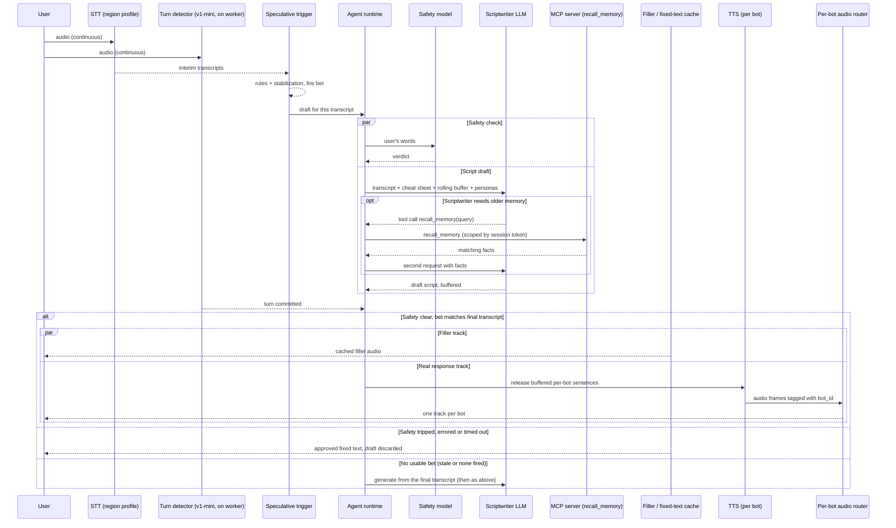

# Voice Companion Architecture

Jaime Aramburo · created Sep 22, 2026 · last revised Oct 18, 2026

This document describes how the system works and why. Decisions are listed in [PLAN.md](PLAN.md) section 3, with full reasoning in [docs/adr/](docs/adr/); the order of work is in PLAN.md; the quality bar is [docs/DESIGN_CHECKLIST.md](docs/DESIGN_CHECKLIST.md). Parts not yet built are described as designed.

## Overview

A real-time voice companion: one user talks with one or two AI companion bots, who listen, decide between them who should answer, reply in their own voices, occasionally talk over each other, and remember earlier conversations. Built for Australia first, with US infrastructure for users in the Americas and Europe.

**Targets** (decision D24), measured from each region: the first audible sound (a cached filler) within **300ms** of the user's turn ending at p50 and 500ms at p95; the first word of the real reply within **1.0s** at p50 and **1.2s** at p95. Cost stays under 3¢ per call-minute.

**Latency is the hard constraint; cost is not.** The worked cost example comes to roughly 1.4–1.7¢ per minute. Three techniques carry the latency: the safety check runs in parallel with a speculative reply draft that starts before the turn is committed; a cached filler sound plays the instant the turn commits; and long-term memory stays off the critical path (a profile summary is loaded at call start, and anything older is fetched by tool only when the bot needs it). Four targets in the original design proved optimistic once measured: under 15ms for the safety pass, under 30ms LiveKit edge transit, under 50ms LLM inference, and a speculative draft firing before the user stops speaking. See Engineering flags for the measured versions; none of them breaks the design.

**Group size:** the user picks 1 or 2 bots from a predefined roster on a room-setup screen before the call. A user with one bot is a supported, intentional mode; 2 bots is the maximum for regular users, and admins (developers) may add any number for testing. The pipeline is generic over N bots. Room size barely changes cost: only one bot speaks per turn (two during a banter interruption), so TTS, output tokens and LiveKit usage don't grow with N. The scriptwriter's input prompt does grow, because every bot's persona and memory summary goes into every request. Token budgets here are sized for 2 bots. The 2-bot limit is enforced in the frontend (UI and server side) and re-checked by the backend at session start against the user's role.

**Languages:** English for the first release (D23b). The turn-taking rules below also cover Mandarin and Spanish, ready for when those languages are added with their own eval sets.

## How the pieces fit

LiveKit, the agent runtime and the MCP server are three separate things:

- **LiveKit** is two parts. *LiveKit Cloud* is LiveKit's media service, which carries the audio. *LiveKit Agents* is a Python library that runs inside our worker and runs the voice loop.
- **The agent runtime** is our Python package. It runs inside the same worker process as LiveKit Agents, which calls it on every turn through `LiveKitBridge`. It talks to the LLM and runs the tool loop.
- **The MCP server** is a separate program of ours. It runs beside the memory database, holds the agent's tools, and is the only piece that reads or deletes memories during a call.

### Terms

| Term | Meaning |
|---|---|
| **Agent** | The AI system as a whole: the agent runtime, the LLM it calls, its tools, guardrails and memory. It decides who speaks and what to say, calls tools, and works within limits enforced in code. |
| **Agent runtime** | Our Python package `companion/agent/`, main class `CompanionAgent`. It runs the agent for each turn and has no LiveKit imports. |
| **LiveKitBridge** | The small class that connects LiveKit Agents to the agent runtime. Named differently because LiveKit's own base class is called `Agent`. |
| **LiveKit agent / agent participant** | LiveKit's name for any program that joins a call room. Here, the participant that speaks for the bots. Plumbing, not the AI agent. |
| **Worker** | Our server process that waits for LiveKit to send it a call, then runs LiveKit Agents and the agent runtime for that call. |
| **Agent name** | The label LiveKit uses to route a call to the workers in one region, for example `companion-au`. |
| **Bot** | One character in a call. All bots in a call are voiced by the same agent in one LLM request. |
| **MCP server** | Our separate program that holds the agent's tools (memory and reminders) and enforces whose data each tool may see. |

### Where each piece runs

| Piece | Runs where | Talks to |
|---|---|---|
| LiveKit Cloud | LiveKit's servers, nearest edge to each user | The browser and our workers |
| Worker process (one per call): LiveKit Agents + agent runtime + audio router | Our servers in AWS, started on demand in the call's region and scaled to zero when idle | LiveKit Cloud, STT, TTS, LLM and safety vendors, the MCP server; Redis only at call start and end |
| MCP server | Our servers in AWS **Sydney**, started on demand whenever any call is active and shared by all calls | Postgres. US workers reach it across the Pacific |
| Extraction job | After each call, in Sydney, started from a queue | Postgres, an LLM |
| Postgres (Supabase) | Sydney | — |
| Redis | Sydney only, free tier | — |
| Eval runner and text CLI | A developer machine or CI | The agent runtime directly (no LiveKit), the MCP server, the LLM |

In development, everything runs on one machine and the agent runtime starts the MCP server itself over stdio.

### Who does what

| Job | Done by | Notes |
|---|---|---|
| Carry audio between the browser and the worker | **LiveKit** (Cloud + Agents framework) | WebRTC, nearest edge, one agent participant per call |
| Send each call to the worker in the right region | **LiveKit** dispatch | One agent name per region, chosen when the call starts |
| Voice activity, turn detection, barge-in | **LiveKit** | v1-mini turn detector on the worker CPU |
| Speech to text and text to speech | **LiveKit** plugins | Built from the session's region profile; vendors are called directly |
| Start drafting early and play fillers | **LiveKit** triggers, **agent runtime** drafts | LiveKit says when; the agent runtime produces the draft |
| One audio track per bot | **LiveKit** output + **our audio router** | The router is our code plugged into LiveKit's audio output |
| Load the memory summary (cheat sheet) at call start | **Agent runtime** asks the **MCP server**; result kept in the worker's memory for the call | All memory reads go through the MCP server, so user scoping lives in one place |
| Build the prompt: every bot's persona, memories and the recent conversation | **Agent runtime** | Fixed section order and token budgets |
| Choose which bot speaks and write its lines | **Scriptwriter LLM** (host chosen by measurement) | One request covers all bots in the call; the LLM acts as the chosen bot |
| Check the LLM's choice | **Agent runtime** | Rejects a reply that names a bot not in the call or breaks a hard limit |
| Call the LLM, with fallback | **Agent runtime** | Primary and fallback hosts per region; switch on rate limit, server error or no first token in time; reply streamed back to LiveKit |
| Run the tool loop | **Agent runtime** | Gives the LLM the tool schemas, forwards its tool calls to the MCP server, enforces the per-turn limit and timeouts |
| Screen user input, fixed wording | **Agent runtime** | Fails closed. Output screening is a pluggable stage, off by default |
| Expose tools (recall, list and forget memories; ask another bot after consent; create and list reminders) | **MCP server** | Never talks to the LLM and never decides when a tool is used |
| Decide whose data a tool may see | **MCP server** | Scope comes from the signed session token, never from the model |
| Embed queries and search memories | **MCP server** | Embedding model loaded once; pgvector in Postgres |
| Write new memories after the call | **Extraction job** | Uses the same memory code as the MCP server; not called by the LLM |
| Store memories, reminders, transcripts, users and bots | **Postgres** (Supabase) | System of record, including vectors |
| Hold per-call state and the cheat sheet | **Worker process memory** | Each call has its own process, so nothing per-turn crosses the Pacific |
| Shared state: the extraction queue | **Redis** in Sydney | Touched only at call start and end, never per turn |

## Layers

No vendor is fixed for any layer (D22): each is chosen by latency measured from both regions when that layer is built, against the targets above. The "Candidates" column lists what has been measured or found so far.

| # | Layer | Candidates and current state | Role |
| --- | --- | --- | --- |
| 1 | Frontend | Next.js on Vercel (separate repo) | Login, room setup, region choice, token issue and dispatch; drops out once WebRTC connects |
| 2 | Transport + VAD | LiveKit Cloud, unpinned; users reach the nearest edge (`aus` or `us`) | WebRTC media routing |
| 3 | Orchestration | LiveKit Agents + our agent runtime, self-hosted in AWS Sydney and the US, started on demand | Runs the whole turn loop next to the media edge |
| 4 | STT | Deepgram Nova-3 or Flux on the Australian endpoint; Deepgram global endpoint in the US; others as found | Streaming transcription, with *preflight* transcripts (see Turn-taking) |
| 5 | Turn detection | LiveKit Turn Detector v1-mini on the worker CPU, or the STT's own end-of-turn signal; selectable per call | Decides when the user's turn has really ended (turn commit) |
| 6 | Safety model | gpt-oss-safeguard-20b on Groq or Amazon Bedrock; others as found | Screens user input in parallel with the draft; fails closed |
| 7 | Memory — Tier 1 (hot) | The worker's own memory, loaded from the MCP server at call start | The profile cheat sheet for this call, read every turn |
| 8 | Memory — Tier 2 (long-term) | Supabase Postgres + pgvector, Sydney, behind the MCP server | Atomic facts and session summaries, searched on demand via `recall_memory` |
| 9 | Memory — Tier 3 (rolling) | In-prompt buffer of the last 10–15 messages | Recent conversation, pruned to protect the token budget |
| 10 | Scriptwriter LLM | gpt-oss-120b on Groq or Amazon Bedrock (in-region in Sydney and the US); others as found. Reasoning always on, low effort | One pass: chooses which bot(s) speak, writes their lines and non-verbal tags, holds every persona; may call tools |
| 11 | TTS | Fish Audio S2.1 hosted (US and Tokyo); Deepgram Aura-2 on the Australian endpoint; Azure Neural TTS (Australia East); Cartesia (Australian deployment, enterprise) | Streaming synthesis, one stream per speaking bot with that bot's voice |
| 12 | Embedding model | Self-hosted sentence-embedding model in the MCP server, chosen by CPU benchmark and retrieval score | Turns text into vectors, when storing memories and when searching them |
| 13 | Memory extraction LLM | Free or cheapest model that extracts accurately (off the live call) | Post-call job: atomic facts and a session summary from each call's transcript |

STT and turn detection are continuous streams, not steps that start after the user stops talking: everything downstream reacts to those streams.

## Regions

The app is built for Australia first. Sessions from Australia, New Zealand and Asia use the `au` profile; sessions from the Americas and Europe use the `us` profile.

**Region choice (D15).** The frontend's server code chooses the region when it issues the LiveKit token, from the country of the user's IP address (Vercel adds it to every request). A `?region=` parameter overrides the choice for testing; the browser's time zone is the fallback when the country is missing; every decision is logged. The worker in each region registers under its own agent name, and rejects a dispatch meant for another region.

**Region profiles (RG-01).** One profile per region names the endpoint for every live-call layer: worker, STT, LLM and safety hosts, TTS. Profiles are validated at startup. Everything off the live call is the same for both profiles and lives in Sydney (D12, D21): the MCP server, the database, the cache and post-call jobs. US calls therefore pay one cross-Pacific round trip at call start (the cheat sheet) and per memory lookup, which the "thinking" filler covers.

**On-demand servers (D27, D35).** Nothing runs around the clock. When the user opens the room-setup screen, the frontend sends a warm-up request that starts a worker in the chosen region and the Sydney MCP server, so they are ready by the time the call starts. Servers stop after a set idle time with no calls. The first visit after an idle period may show a short wait. The AWS service is chosen by measured start-up time and cost.

**Failover (D26).** If a live-call vendor fails, the session may fall back to its equivalent in the other region; every fallback is logged. This can send Australian audio to US vendors, which is flagged for the privacy review.

**Memory residency (RG-04).** Every user's memories live in Sydney, the single home region; see [ADR 0003](docs/adr/0003-pay-only-for-live-call-latency.md).

### Provider regional options (checked 2026-10-17)

These are the options found for each layer, not choices.

| Layer | Australia (default) | United States | Finding |
|---|---|---|---|
| Agent worker | **Self-hosted in AWS `ap-southeast-2`** | Self-hosted in AWS `us-east-1` or `us-west-2` (measured, D25) | LiveKit Cloud hosts agents only in `us-east`, `eu-central` and `ap-south`, so an Australian worker must be self-hosted. Multi-region routing gives each regional deployment its own agent name and dispatches explicitly. |
| Media transport | LiveKit `aus` region group | LiveKit `us` region group | `aus` is a single location without in-region redundancy; `us` has three. Region pinning is per **project**, needs the **Scale** plan or higher, is switched on by LiveKit support, and has no automatic failover. An unpinned project routes each client to its nearest cluster; pinning to `aus` would force US users through Australia, so the project stays unpinned (D10). |
| STT | Deepgram `api.au.deepgram.com` | Deepgram `api.deepgram.com` (global, US) | The AU endpoint serves Nova-3, Flux (`/v2/listen`) and Aura-2 TTS (`/v1/speak`). Requests to it never leave Australia: if the region is down they fail rather than fall back, so failover must be explicit. |
| LLM hosting (scriptwriter and safety) | Groq, Sydney data centre; Bedrock `ap-southeast-2`; others to be listed | Groq, US data centres; Bedrock `us-east-1`, `us-east-2`, `us-west-2` | Bedrock serves gpt-oss-120b in-region in Sydney and all three US regions; safeguard-20b in the US is still to be confirmed. Groq routes automatically to its nearest data centre, but its paid tier is not currently offered, so free-tier rate limits apply. |
| TTS | Fish hosted API is served from the US and Tokyo only | Fish hosted API (US) | Fish suits US sessions and is the slowest stage for Australian ones (~465–520ms to first audio). Australian options: Deepgram Aura-2 on the AU endpoint (self-serve), Cartesia's Australian deployment (enterprise only), Fish S2.1 through a third-party host advertising Sydney compute (unverified), Azure Neural TTS in Australia East. |
| Turn detection | v1-mini on the worker CPU | Same | The full v1 model is served on LiveKit Inference and is free for agents deployed on LiveKit Cloud; v1-mini is recommended for self-hosted agents. |
| Backchannel handling | Our own rule (see Turn-taking) | Same | LiveKit's adaptive interruption model (filters "mm-hm") is included for agents deployed on LiveKit Cloud, with 40,000 free requests a month in development; a self-hosted worker needs its own rule. |
| MCP server | Self-hosted in Sydney beside the database | US workers call the Sydney server | No vendor dependency. |
| Vector store | pgvector in Supabase, Sydney | Same database, read cross-region | Free: already part of the database. |
| Cache | Upstash Redis `ap-southeast-2`, free tier | Same Sydney database | Holds only shared state touched at call start and end, so one free Sydney database serves both regions. |
| Database | Supabase, Sydney | — | One project; its region is fixed (D12). |
| Embeddings | Self-hosted model in the MCP server | Same | Runs wherever the server runs. |

## Pluggable providers

Every external endpoint (STT, TTS, the scriptwriter and safety LLMs, the turn detector and the speculative-trigger strategy) is swappable without code changes. Comparing provider combinations is an ongoing part of building this, not a one-time choice.

A provider registry maps preset names (for example `deepgram_nova3_au`, `fish_s21_hosted`, `bedrock_gptoss120b_syd`) to configured LiveKit plugin or client instances (auth, model, region). Each region profile names its default presets. A test UI in the frontend exposes the presets as dropdowns, resolved server-side into preset names and sent to the worker in the **agent-dispatch metadata** at session start (`createDispatch(...)`, read back from `ctx.job.metadata`). Presets are chosen per session, never swapped mid-call, except for the automatic fallback of a single failed LLM request described below.

**Per-call selectable presets** (names are provisional; the registry is the source of truth):

| Dropdown | Candidate presets | Default |
| --- | --- | --- |
| STT | `deepgram_nova3_au`, `deepgram_flux_au`, `deepgram_nova3_global`, `inworld_stt1` | The region profile's choice |
| TTS | `fish_s21_hosted`, `deepgram_aura2_au`, others as measured | The region profile's choice |
| LLM (scriptwriter) | `groq_gptoss120b`, `bedrock_gptoss120b_syd`, `bedrock_gptoss120b_us`, others as measured | The region profile's primary, with its fallback |
| Safety model | `groq_safeguard20b`, `bedrock_safeguard20b_syd`, others as measured | The region profile's primary, with its fallback |
| Turn detector | `livekit_v1_mini`, `stt_native` | `livekit_v1_mini` |
| Speculative trigger | `auto`, `livekit_preemptive`, `transcript_rules`, `transcript_debounce_only`, `vad_silence` | `auto` |

**Compatibility rules** (the backend rejects an invalid combination at session start with a clear error; the frontend greys out invalid options):

- `stt_native` turn detection is only valid with an STT that reports end-of-turn itself (Deepgram Flux, Inworld; not Nova-3).
- `auto` speculative trigger resolves by STT: `livekit_preemptive` for STTs whose LiveKit plugin emits *preflight* transcripts (Deepgram, AssemblyAI, Soniox, Cartesia), `transcript_rules` otherwise (Inworld). See Turn-taking.
- A preset whose credentials aren't configured is rejected at session start; only the keys a region profile needs are required at startup.
- **Automatic fallback (LLM and safety):** a request that is rate-limited (HTTP 429), fails (5xx) or produces no first token within its time budget is retried once on the profile's fallback host, within the same turn. Retrying is safe because nothing has been spoken yet. Every fallback is logged with the reason.

**Config-only, not per call:**

- **Embedding model.** Vectors from different models aren't comparable, so every stored memory is embedded with the model that searches it. Changing it means re-embedding every memory: a deliberate migration, never a dropdown.
- **Memory extraction LLM.** Runs after the call.

The worker (Python, where the vendor plugin ecosystem is most complete) owns the registry and the provider instances; the frontend (TypeScript) owns the dropdowns and the dispatch call. LiveKit's dispatch and room APIs are the only channel between them. The dispatch-metadata shape is in Frontend contract.

## Turn-taking: turn detection vs speculative bets

Two separate mechanisms with two different jobs:

| | Speculative trigger ("the bet") | Turn detection ("the commit") |
| --- | --- | --- |
| Job | Start the safety check and script draft early | Decide the user has really finished; release audio |
| Cost of being wrong | A wasted, discarded LLM call | A bot talks over the user |
| Tuned for | Speed; allowed to be wrong | Accuracy |

### Turn detection

Selectable per call (`turn_detector` preset):

- **`livekit_v1_mini` (default)** — LiveKit's audio-based turn detector, running **locally on the agent's CPU** in Sydney (no network hop). The v1 model family takes raw audio as input, not a transcript: a neural network trained on finished vs. unfinished speech, with a semantic branch (learned to follow word content directly from sound) and an acoustic branch (intonation, rhythm), fused into one end-of-turn probability. It runs once VAD sees ≥0.25s of silence; per-language thresholds turn the probability into a commit. It only uses the STT's detected language to pick the threshold, so it works identically whichever STT is chosen. v1-mini is the quantized/pruned version: "most of v1's accuracy" (no separate figures published). Needs compute-optimized instances (AWS c6i/c7i) to avoid timeouts.
- **`stt_native`** — use the STT's own end-of-turn signal (LiveKit `turn_detection="stt"`). With **Deepgram Flux** it runs in Sydney alongside transcription (Deepgram serves Flux on its Australian endpoint); LiveKit's benchmark puts Flux at 12.9% false cutoffs at a 300ms budget and 9.9% at 600ms. Inworld's plugin also exposes end-of-turn settings, with no published accuracy figures.
- **Not used: `livekit_v1`** — the full model is served on LiveKit Inference and is free for agents deployed on LiveKit Cloud, whose agent hosting has no Australian region (US, Frankfurt, Mumbai). LiveKit recommends v1-mini for self-hosted agents. Reference figures from LiveKit's own benchmark: 9.9% false cutoffs at 300ms, 4.5% at 600ms.

Defaults with the audio model: minimum endpointing delay 0.3s, maximum 2.5s — tunable, and worth tuning on real users' speech — some users pause mid-sentence for longer than average.

**Backchannels.** Short acknowledgements while a bot is speaking ("mm-hm", "yeah", "right") must not stop the bot or trigger a new reply. LiveKit's adaptive interruption model handles this only for agents deployed on LiveKit Cloud, so the self-hosted worker uses its own rule: overlapping user speech that is short and matches a backchannel word list in the session's language doesn't count as an interruption. The rule is tested in simulation.

### Speculative trigger

**Every bet fires on an event** — a transcript update or a silence event — never on a timer, and never as a prediction of the future. Streaming STT sends its current best guess of the sentence several times a second and revises it as it hears more; each trigger strategy is just a rule for which of those updates is worth betting on. When a bet turns out wrong (the user keeps talking), it's cancelled and a new one may fire at the next plausible ending.

Selectable per call (`speculative_trigger` preset):

1. **`vad_silence`** — bet on whatever the transcript says after a fixed silence (e.g. 150ms). Fewest wasted bets, slowest; ignores the words entirely. Kept as a comparison baseline.
2. **`transcript_debounce_only`** — bet when the transcript stops changing for a short window (e.g. 100ms) and the STT's predicted punctuation looks terminal (`.` `?` `!`).
3. **`transcript_rules`** — #2 plus an instant word-rule check first (table below). Blacklist hit: block the bet. Whitelist hit: fire immediately without waiting for the debounce window. Everything else falls through to #2.
4. **`livekit_preemptive`** — LiveKit's built-in `preemptive_generation`. It doesn't inspect words or silence itself; it fires on the STT's events: every *final* transcript segment (any STT), and additionally on *preflight* transcripts (an early "this looks finished" message that only some STT plugins emit — Deepgram, AssemblyAI, Soniox, Cartesia). Built-in cancel/re-bet, capped by `max_retries` (default 3) and `max_speech_duration` (default 10s).
5. **`auto` (default)** — `livekit_preemptive` with preflight-capable STTs (so `livekit_preemptive` with the default Deepgram STT), `transcript_rules` with Inworld. Reason: the Inworld plugin emits no preflight transcripts, and emits its *final* transcript at the same moment it declares end-of-speech (after its own ≥200ms silence rule). With Inworld, `livekit_preemptive` would therefore fire later than our own trigger, which reads Inworld's in-progress interim text.

**`transcript_rules` step by step**, e.g. *"I was just thinking about my sister's coming to visit this weekend, … isn't that nice."* (brief pause after "weekend"):

1. Interim text streams in; each update restarts the stabilization timer.
2. Each update's last word is checked against the rule lists: blacklist → no bet; whitelist → fire now; otherwise → step 3.
3. Text unchanged for the debounce window + terminal punctuation → **fire a bet**.
4. A bet = **safety check + scriptwriter draft, in parallel**, on that exact text. The draft is buffered, never played. (The scriptwriter already has the profile cheat sheet in its prompt; if it calls `recall_memory`, that happens inside the bet — see Memory.)
5. They pause after "weekend" → bet #1 fires. "isn't that nice" arrives → text changed → bet #1 is **cancelled immediately** (LLM stream stopped, so output tokens stop being billed) and the bet counter goes to 1.
6. "…isn't that nice." settles → bet #2 fires. They stay silent.
7. Turn detector commits. If the bet's text matches the final transcript, its draft is used; otherwise it's discarded and a fresh generation starts. Then the safety gate (see sequence diagram).

**Rules for all trigger strategies:**
- **Only one bet in flight.** A new bet always cancels the previous one first.
- **Bet cap: 3 per user turn, plus a 10-second speech cut-off** (both tunable). The counter resets at turn commit. After the cap, no further bets that turn; the reply is generated at turn commit (slower by roughly one LLM first-clause time, covered by the filler).
- **The commit can win the race.** If turn detection commits before any bet has fired (e.g. the STT is slow to deliver the last words), the commit itself triggers generation. No head start that turn; nothing breaks.
- **Metrics per turn**, logged with session/turn id and active presets: bets fired, bets wasted, and time between the used bet firing and turn commit. Defaults get chosen from this data, not guessed.

**Why the cap and rules matter at scale:** a wasted bet costs one scriptwriter call + one safety call (\~$0.00013 for the scriptwriter at the cost model's rates). At \~3 user turns/min and up to 3 wasted bets per turn, that's up to \~0.12¢/min — up to \~7–9% of the \~1.4–1.7¢/min total in the worst case. The goal is the earliest bet with the fewest misses, not the most bets.

English is used for the first release; the Mandarin and Spanish rows are ready for when those languages are added.

| Language | Blacklist (blocks the bet) | Whitelist (fires immediately) |
| --- | --- | --- |
| English | `the`, `a`, `an`, `and`, `but`, `or`, `my`, `your`, `because`, `uh`, `um` — **not** trailing prepositions (`to`, `for`, `with`, `at`, `on`): these are common, grammatical sentence endings in spoken English ("Who's that for?"), blacklisting them would slow down normal speech | Starts with `How`/`What`/`Who`/`Why`/`Are you`/`Can you` + a verb phrase; or ends on a temporal anchor (`today`, `yesterday`, `right now`) or a name (`Paul`, `Gary`) |
| Mandarin | Trailing `的` (de), `和` (he, "and"), `因为` (yinwei, "because") — unfinished connectors/particles | Ends on a sentence-final particle: `了` (le), `吗` (ma), `呢` (ne), `吧` (ba) — these grammatically sit almost exclusively at true clause boundaries, arguably a stronger signal than any English rule |
| Spanish | Trailing bare article (`el`, `la`, `los`, `las`, `un`, `una`); trailing `y` (and), `pero` (but), `porque` (because) | Starts with `¿Qué`, `¿Cómo`, `¿Quién`, `¿Por qué`, or inverted-question form |

**Be honest about what the rule layer buys you:** it only resolves the clear-cut edges of the distribution — obviously-unfinished trailing tokens, and short obviously-complete utterances (greetings, simple questions). Most real conversational sentences are neither blacklisted nor whitelisted and still fall through to the debounce+punctuation baseline, which stays the primary mechanism, not a rare fallback. Treat the rule layer as a cheap accelerant that reduces wasted/wrong bets on the edges, not a replacement for the baseline. The stabilization thresholds were reasoned about against Deepgram's interim-result behaviour; validate them against Deepgram's measured cadence from Sydney, and re-validate for any other STT preset.

## Safety gate

A separate safety model screens each **user turn**, in parallel with the speculative reply draft; the verdict only has to arrive before the turn commits ([ADR 0004](docs/adr/0004-screen-input-in-parallel-and-fail-closed.md)).

- **Fails closed.** An error, timeout or unparseable verdict is treated as unsafe: the draft is discarded and approved fixed text is spoken instead.
- **Fixed wording bypasses the LLM.** Crisis responses (with the helpline for the session's region), refusals and consent prompts are approved text, chosen per region profile, never generated.
- **Category to action.** Each safety category maps to an action (block, rephrase, or fixed text), recorded in a decision record when the gate is built.
- **Bot output is not screened by default.** Output screening is a pluggable stage that can be switched on by configuration. When on, it checks each sentence while TTS prepares it and holds that sentence's audio until the verdict arrives, so screening hides inside TTS time to first audio.
- **No second check.** There is no supervisor model on sensitive turns.
- **Speaker limits.** The scriptwriter chooses who speaks, within hard limits checked in code: the speaker must be a bot in the call; one speaker per turn, two during banter; banter can be switched off on safety-sensitive turns; a reply that breaks a limit is regenerated once, then replaced by a safe line.

## Sequence diagram

The safety check runs **alongside** the speculative script draft, not in front of it. Long-term memory is not in the parallel block: the cheat sheet is already in the prompt, and a Tier 2 lookup only happens if the scriptwriter asks for one. If safety trips, the `alt` branch swaps in fixed text instead of the draft.



The bet starts safety and the draft the moment the transcript settles, and neither waits for the other. Turn detection commits on its own clock. Only at commit does the `alt` gate decide whether the buffered script or fixed text is released to audio.

## Latency budget — concrete example

User says: *"Oh you know, I was just thinking about my sister's coming to visit this weekend, isn't that nice."* `T=0` = the user stops speaking. Targets: first audible sound within 300ms of turn commit (p50), first word of the real reply within 1.0s (p50) and 1.2s (p95).

| Time | Event |
| --- | --- |
| before the first turn | Cheat sheet loaded from the MCP server into the worker's memory |
| throughout utterance | STT streams interim and preflight transcripts; a bet may fire and be cancelled at the pause after "weekend" |
| T ≈ 0 to +100ms | Last words land in the transcript; text settles, bet fires: safety + script draft in parallel |
| T ≈ bet + tens to ~120ms | Safety verdict lands (the fastest measured safety host answered in ~117ms) |
| T ≈ bet + time to first token | Script draft's first sentence buffered (measured ~400–530ms to first visible text on managed hosts from Australia, most of it provider queueing) |
| T ≈ +300ms or later | Turn detector commits (v1-mini: ≥0.25s VAD silence, minimum endpointing delay 0.3s, tunable) |
| T ≈ turn commit | Verdict already there, gate fires: cached filler dispatched (no compute) **and** buffered script released to TTS at the same instant |
| T ≈ commit + 20–80ms | Filler audio reaches the user: first audible sound |
| T ≈ commit + TTS first audio | Real audio streams in behind the filler; filler lengths are tuned to the chosen TTS's measured time to first audio |

A bet can only contain words the STT has already transcribed, so it cannot fire before the user stops speaking; the head start that matters is bet to commit (here roughly 200ms). The load-bearing assumption: **the bet fires and the safety verdict lands before turn commit.** If the bet is late, the commit triggers generation itself and that turn loses its head start. Turns that call `recall_memory` pay extra (one embedding, one pgvector query, a second LLM request; roughly +150–300ms estimated, plus a cross-Pacific round trip for US sessions); the "thinking" filler covers it.

## Memory

### Reading memory during a call

- **Tier 1 — profile cheat sheet.** At session start, the agent runtime asks the MCP server for the user's cheat sheet: the highest-importance active facts plus the most recent session summaries, filtered per bot to what that bot witnessed. It is held in the worker's memory for the call and goes into every scriptwriter prompt. Well built, it answers most turns without a lookup.
- **Tier 2 — `recall_memory` tool (on demand).** The scriptwriter calls `recall_memory(query, other_bot=None)` only when the cheat sheet and rolling buffer don't answer the turn. The agent runtime forwards the call to the MCP server, which derives the user and calling bot from the session token, embeds the query, and searches that user's active facts that the bot witnessed (see Database schema). One lookup per turn; each call has a timeout. The prompt is firm that the tool is for gaps only, and tool-call rate is logged per session.
  - Retrieved memories enter the prompt in a delimited data block; they are facts, never instructions.
  - The safety verdict from the first request carries over to the tool's second request (the user's words haven't changed).
  - **"Thinking" filler:** if a lookup is still pending at turn commit, a thinking filler plays ("Hmm, let me think…"). A lookup that finishes before commit is inaudible.
- **Tier 3 — rolling buffer.** The last 10–15 messages of the current call, in the prompt.
- **Never raw transcripts from other calls.** The scriptwriter only ever sees extracted facts and summaries from earlier calls.

### Sharing memory between bots

Memories belong to the user but are **scoped to the bots that witnessed them** (were in the room when it was said).

- A bot's cheat sheet and default `recall_memory` searches only include memories that bot witnessed.
- If the user asks a bot about something they only told a different bot, the bot says it doesn't recall and **offers to ask the other bot**: *"I don't recall you mentioning it, but I can ask Jason if you like?"*
- Only after the user agrees does the bot call `recall_memory(query, other_bot="jason")`, and it answers with attribution: *"Jason says it was Luigi's on Crown Street!"* A bot never volunteers another bot's memories unprompted.
- If the other bot is in the same room, the scriptwriter can simply have that bot answer.

### User control over memory

- **"What do you remember about me?"** The bot answers with a brief summary written by the LLM from the user's active memories that bot may see, within a length limit.
- **"Forget that."** Works only when the user switched memory deletion on in room setup before the call (off by default). Only specific memories can be deleted; there is no "forget everything" by voice. Deletion sets `is_active = false`, which removes the memory from the cheat sheet and every search; the row stays in the database. Deleting the account removes all of the user's data.
- **Misheard details.** Before a name or date heard with low confidence is stored, the bot confirms it with the user.
- **Retention** is unlimited for now (D13), a documented policy for the privacy review.

### Writing memory: post-call extraction

When a call ends, its session id goes onto a queue in the Sydney Redis, and a job in Sydney processes the transcript, so memories are available minutes later and every extracted fact inherits the session's bots as its witnesses:

1. Load the session's messages and the user's existing related facts.
2. An LLM extracts **atomic facts** (standalone sentences about the user: preferences, people, places, health, emotional triggers, including entities mentioned once) and a **session summary**.
3. Rules: only facts the **user** stated or confirmed, never bot-invented content; relative dates resolved to absolute dates (`occurred_at`); a kind (fact, preference or event), an importance score and a confidence per fact; output validated against a typed schema and retried if malformed.
4. For each candidate fact: **ADD** (new), **UPDATE** (changes an existing fact; the old one gets `superseded_by`) or **SKIP** (already known), so memory compounds without duplicates or contradictions.
5. Embed new and updated facts and write them with their witness rows.

The job is idempotent per session id, so a failed run is retried safely.

### Embeddings

pgvector stores vectors and finds the nearest ones; it does not create them. The self-hosted embedding model, loaded once in the MCP server, turns text into vectors at write time (extraction job) and at read time (`recall_memory`). One model for all stored vectors; its dimension fixes the column size; each row records which model produced it.

## Actions: reminders

Bots can set reminders by voice: *"Remind me about my appointment on Thursday."* The MCP server exposes tools to create and list reminders, with policies enforced in code, not left to the prompt:

- the bot reads the date and time back and gets a clear yes before saving;
- dates are resolved in the user's time zone;
- dates in the past are rejected.

Reminders live in a `reminders` table in Postgres. Due reminders are loaded at call start with the cheat sheet, so a bot brings them up in the next call. Evals check the reminders that exist after a conversation. A reminders list in the frontend comes later; there is no sync to external calendars.

## Database schema (owned by the backend repo)

**Ownership, now that this is split into a frontend and backend repo:** the actual Supabase Postgres schema and its migrations live in and are applied from the **backend** repo (`supabase/migrations/`), even though both repos read/write this database — backend for memory and transcripts, frontend for user accounts, room/session history, and anything else user-facing. One schema, one place migrations are written and applied, so two independently-edited repos don't drift apart on what the tables actually look like.

The frontend repo consumes the schema through Supabase's generated TypeScript types (`supabase gen types typescript`), regenerated after any schema change — never hand-typed to match an assumption about what a table looks like. If frontend work surfaces a need for a new table or column, the shape gets drafted and added as a migration in the backend repo, then frontend's types get regenerated from the live schema.

### Naming convention

**Every table and column is snake_case**, with no exceptions for third-party libraries. Application code may use other conventions (e.g. camelCase in TypeScript) only through its own mapping layer.

**Names are product-neutral:** tables, columns, enum values and seed data describe the generic product (the person in a call is a `user`), never a specific audience.

### Auth tables — custom Auth.js adapter

Login is handled by **Auth.js in the frontend** (a JavaScript library; the Python backend never uses it — it receives the user's `user_id` in dispatch metadata). Providers: Google + email/password (Credentials), with **JWT sessions**.

Auth.js never touches the database itself; it passes camelCase JavaScript objects (`emailVerified`, `providerAccountId`, …) to a **database adapter**. The off-the-shelf adapters (`@auth/pg-adapter`, `@auth/supabase-adapter`) hard-code camelCase column names, and the ORM-based ones (Prisma, Drizzle) would add a second database library to the frontend whose table definitions must be hand-synced with the migrations here. Neither is acceptable, so **the frontend implements a small custom adapter** on `supabase-js`, typed from the generated Supabase types, that maps Auth.js's objects onto these snake_case tables. With JWT sessions and no email-verification flow, it only needs the user and account methods (roughly `createUser`, `getUser`, `getUserByEmail`, `getUserByAccount`, `updateUser`, `linkAccount`); session methods are never called.

Migration `20260930065124` (the migration file is authoritative; summary):

```sql
CREATE TYPE user_role AS ENUM ('admin', 'user');

CREATE TABLE users (
    id             uuid        PRIMARY KEY DEFAULT gen_random_uuid(),
    name           text,                          -- nullable: not every OAuth profile provides one
    email          text        NOT NULL UNIQUE,   -- always stored lowercase (CHECK below)
    email_verified timestamptz,                   -- set by Auth.js for OAuth sign-ins
    image          text,
    password_hash  text,                          -- null for Google-only accounts
    role           user_role   NOT NULL DEFAULT 'user',  -- admin: unlimited bots per call (testing)
    created_at     timestamptz NOT NULL DEFAULT now(),
    updated_at     timestamptz NOT NULL DEFAULT now(),   -- maintained by a trigger
    CHECK (email = lower(email))
);

-- One row per OAuth provider login linked to a user (e.g. their Google account).
-- Token columns mirror the OAuth fields Auth.js passes through.
CREATE TABLE accounts (
    id                  uuid    PRIMARY KEY DEFAULT gen_random_uuid(),
    user_id             uuid    NOT NULL REFERENCES users (id) ON DELETE CASCADE,
    type                text    NOT NULL,
    provider            text    NOT NULL,
    provider_account_id text    NOT NULL,
    refresh_token       text,
    access_token        text,
    expires_at          bigint,
    token_type          text,
    scope               text,
    id_token            text,
    session_state       text,
    UNIQUE (provider, provider_account_id)
);
CREATE INDEX accounts_user_id_idx ON accounts (user_id);
```

- **No `sessions` table** — JWT sessions never use it. Add one only if the app moves to database sessions.
- **No `verification_tokens` table** — only needed for email verification or magic-link sign-in; add it with that feature.
- `user_id` is always the end user (the person talking to the bots); every other table's `user_id` references `users (id)`.

**Email case:** emails are stored **lowercase only** — a CHECK constraint rejects anything else, so uniqueness is a plain `UNIQUE` and lookups are simple equality from `supabase-js`. The frontend's Auth.js adapter lowercases emails before every insert and lookup; forgetting to fails loudly (constraint error) rather than creating a duplicate account.

**RLS is mandatory:** Supabase exposes `public` tables through its API, so every table — especially `users` with `password_hash` — has RLS enabled. With Auth.js (not Supabase Auth), Supabase's `auth.uid()` doesn't work out of the box; until user-facing policies are designed, tables are accessed only server-side (frontend with the service-role key, backend over a direct Postgres connection) and RLS denies everything else. Migrations also revoke the default table privileges Supabase grants to its `anon` and `authenticated` API roles, so the browser-facing roles have no access even if a policy is added by mistake.

### How the tables relate

```
users ──1:N── accounts                         (login providers)
  │
  ├──1:N── sessions ──N:M── bots               (via session_bots: which bots were in each call)
  │           │
  │           └──1:N── messages ──N:1── bots   (who said each line: the user, or a bot)
  │
  ├──1:N── memories ──N:M── bots               (via memory_witnesses: which bots heard each memory)
  │           ├── N:1 → sessions               (the call it was learned in)
  │           └── N:1 → memories               (superseded_by: the newer fact that replaced it)
  │
  └──N:M── bots                                 (via user_bot_relationships: how well each bot knows the user)
```

**Delete rules:** deleting a **user** cascades to everything that belongs to them (accounts, sessions, transcripts, relationships, memories) — the right to be forgotten. **Bots** are never deleted while anything refers to them (`ON DELETE RESTRICT`); they're retired with `is_active = false`. Deleting a **session** cascades to its bot list and transcript, but a memory learned in it survives (`session_id` becomes null).

**Same-user guarantee:** tables partitioned by `user_id` reference their parent with `(user_id, id)` pairs rather than `id` alone (e.g. `messages (user_id, session_id) → sessions (user_id, id)`), so the database itself guarantees a transcript line or memory can't be attached to another user's session or memory.

### Calls, bots and transcripts (migration `20260930073542`)

The authoritative definitions are in the migration file; summary:

- **`bots`** — the roster: `slug` (short fixed name, e.g. `gary`), `display_name`, `persona_prompt` (personality text the scriptwriter reads), `ui_description` (room-setup bio), `avatar_url`, `voice_id` (TTS voice reference), `is_active`, timestamps. Referenced by `session_bots`, `messages`, `user_bot_relationships` and `memory_witnesses`.
  - *Designed, not yet migrated* ([ADR 0007](docs/adr/0007-bots-are-versioned-database-rows.md)): the remaining definition fields (a voice per TTS preset, because each TTS vendor has its own voice IDs; a memory policy; allowed tools; per-bot safety settings), and an immutable `bot_versions` table. Models per role belong to the region profile, not the bot, because one scriptwriter request voices every bot in the call. The typed shape is `BotDefinition` in `src/companion/contracts/`. Editing a bot creates a new version; a release pins version IDs. Every row is validated by a strict model when loaded.
- **`sessions`** — one row per call: `user_id → users`, `livekit_room_name`, `status` (`active` / `ended` / `failed`, kept consistent with `ended_at`), `end_reason`, one column per chosen preset (`stt_preset`, `tts_preset`, `llm_preset`, `safety_preset`, `turn_detector_preset`, `trigger_preset`), `started_at`, `ended_at`. *Designed, not yet migrated:* `region` (`au` / `us`) and `memory_deletion_enabled` (the user's room-setup toggle).
- **`session_bots`** — junction table: which bots were in each call (`session_id`, `bot_id`). The source of truth for "who was in the room", copied into `memory_witnesses` by the post-call job.
- **`messages`** — the transcript, one row per spoken line: `session_id`, `seq` (order within the call), `speaker` (`user` / `bot`), `bot_id` (set exactly when a bot spoke), `text` (what was actually **heard**), `interrupted` (bot lines only), `spoken_at`. Hash-partitioned by `user_id` into 16 partitions.
- **`user_bot_relationships`** — one row per (user, bot) pair that has talked: `first_met_at`, `last_call_at`, `call_count`, `rapport_level` (1 = just met … 10 = close friend) and `rapport_notes` (short summary), both maintained by the post-call job. The scriptwriter reads it so each bot treats the user as a new acquaintance or an old friend as appropriate.

**Frontend note:** the room-setup screen reads `bots` (active only) server-side with the service-role key; the browser roles have no access (RLS).

### Memory and reminder tables (designed, not yet migrated)

**Written once the embedding model is chosen (PLAN.md step S6)**, because the model fixes the vector column's size.

`user_id` is always the end user (the person talking to the bots) and references `users (id)`.

```sql
CREATE TYPE memory_type AS ENUM ('core_fact', 'session_summary');
CREATE TYPE memory_kind AS ENUM ('fact', 'preference', 'event');  -- core facts only

CREATE TABLE memories (
    id              uuid        NOT NULL DEFAULT gen_random_uuid(),
    user_id         uuid        NOT NULL REFERENCES users (id) ON DELETE CASCADE,
    session_id      uuid,                              -- call it came from (→ sessions, see below)
    type            memory_type NOT NULL,
    memory_text     text        NOT NULL,
    kind            memory_kind,                       -- core facts only
    importance      smallint    CHECK (importance BETWEEN 1 AND 10),  -- core facts; drives the cheat sheet
    confidence      real        CHECK (confidence BETWEEN 0 AND 1),   -- how sure extraction was
    is_active       boolean     NOT NULL DEFAULT true,  -- false once the user asks to forget it
    embedding       halfvec(768),                      -- dimension fixed by the chosen embedding model
    embedding_model text,
    occurred_at     timestamptz,                       -- when the event happened, not when stored
    created_at      timestamptz NOT NULL DEFAULT now(),
    superseded_by   uuid,                              -- set when a later fact replaces this one (→ memories, see below)
    PRIMARY KEY (user_id, id),                         -- partition key must be part of the PK
    CHECK (type <> 'core_fact' OR embedding IS NOT NULL)
) PARTITION BY HASH (user_id);

-- Which bots were present when a memory was said (the sharing rule).
-- A join table rather than an array column so bot_id can be a real foreign key.
CREATE TABLE memory_witnesses (
    user_id   uuid NOT NULL,
    memory_id uuid NOT NULL,
    bot_id    uuid NOT NULL REFERENCES bots (id) ON DELETE RESTRICT,
    PRIMARY KEY (user_id, memory_id, bot_id),
    FOREIGN KEY (user_id, memory_id) REFERENCES memories (user_id, id) ON DELETE CASCADE
);

-- recall_memory: exact search, scoped to one user + one bot
SELECT m.memory_text, m.occurred_at
FROM memories m
JOIN memory_witnesses w ON w.user_id = m.user_id AND w.memory_id = m.id
WHERE m.user_id = $1 AND w.bot_id = $2
  AND m.type = 'core_fact' AND m.is_active AND m.superseded_by IS NULL
ORDER BY m.embedding <=> $3
LIMIT 5;
```

Further references in the final migration: `(user_id, session_id) → sessions (user_id, id)` with `ON DELETE SET NULL (session_id)` so a memory outlives its call, and `(user_id, superseded_by) → memories (user_id, id)` so a fact can only be replaced by the same user's fact. Transcripts are in `messages` (above). **Retention is unlimited for now** (D13), and forgetting a memory deactivates it rather than deleting the row; both are flagged for the privacy review.

The `reminders` table (user, the bot that set it, text, due time with the user's time zone, status, the session it came from) is designed with its migration in plan step S20.1, following the same rules: partitioned or keyed by user, same-user composite references, RLS on with no policies.

**Indexing and performance decisions:**
- **Exact vector search per user, no HNSW (for now).** pgvector applies `WHERE` filters *after* an HNSW index scan (default `hnsw.ef_search` = 40 candidates), so an HNSW index shared by many users would, for one user, return few or no rows. A single user's history is thousands of rows, not millions, so the primary key's `user_id` prefix narrows to that user's rows and Postgres computes exact distances on them — 100% recall, expected low-single-digit ms (to be benchmarked). HNSW (with pgvector ≥0.8 iterative scans) is only worth revisiting if individual histories grow very large.
- **Hash partitioning by `user_id`** — for maintenance (smaller per-partition indexes, faster vacuum) and cache locality, not for vector-search correctness. Cheap to set up now, expensive to retrofit onto a large live table. Partition count TBD.
- **`halfvec`** — half-precision storage halves table and index size with negligible recall loss.
- **Connection path: Supabase's transaction pooler (Supavisor, port 6543) plus a small client-side pool held open by the agent.** The client-side pool means no lookup pays connection setup; the pooler lets thousands of calls share a small number of real database connections. Direct or session connections don't scale here: Postgres has a hard connection limit, and LiveKit runs each call in its own process, so per-call connections would exhaust it. Transaction pooling can't support prepared statements, so they're disabled in the driver; no session-level Postgres features are needed (anything that must be set is set within a single transaction).

**Row-level security:** every table has RLS on with **no policies** (the browser-facing roles get nothing; server-side access bypasses RLS). User-facing policies are designed if the frontend ever needs direct browser access. Memories and transcripts hold sensitive personal and health information and must never be readable from the browser.

**Future, not now:** delegated access to a user's memories (e.g. by a family member) — an additive access table linking another account to that user; no change to the memory tables.

Once finalized, the schema itself stays documented here, so both repos' copies of this doc stay in sync when it changes.

## Multi-bot audio output

One LLM writes the script for all bots; the agent runtime splits it into per-bot sentences, each is synthesized with that bot's voice (parallel TTS streams), and each bot is published on its own audio track. The browser plays all tracks; overlaps blend naturally.

**Design (pending prototype, plan step S12):** one `AgentSession`, one agent participant, **one audio track per bot**, named `bot:<bot_id>`.

- `AgentSession` keeps the input side and what it provides: STT, turn detection, speculative generation, barge-in handling and fillers. `LiveKitBridge` replaces its LLM step (`llm_node`) with a call into the agent runtime.
- Its audio output (`session.output.audio`) is a documented, replaceable component. We replace the default single-track output with a **per-bot router**: the TTS step tags every audio frame with its `bot_id` in the frame's `userdata`, and the router pushes each frame onto that bot's track.
- **Barge-in:** when the user interrupts, the router's clear/stop empties **all** bot tracks at once, including during a banter overlap. The stored transcript keeps only what was actually heard.
- **Speaking indicator:** LiveKit's built-in active-speaker detection is per *participant*, so it can't tell bots on one participant apart. The router knows when it starts and stops each bot's audio and sends `bot_speaking` data messages (see Frontend contract).
- **Captions (optional):** LiveKit Agents' transcript stream is synchronized to playback and can be attributed to a specific track — per-bot captions, useful for accessibility.
- **Unverified, first thing the prototype checks:** that the `userdata` tag survives every pipeline stage from the TTS step to the output. LiveKit's own source relies on the same mechanism to carry transcript timing, which strongly suggests it does.

## Bot-to-bot interruption (banter)

Goal: bots should be able to cut each other off mid-sentence the way people do — Gary bragging about tomatoes, Paul barging in with "Hold your horses, young man..." — with both voices audibly overlapping for a beat before Gary's line fades out.

**No server-side mixing:** LiveKit's SFU does not mix audio server-side — it "forwards a copy of each track to each subscriber without manipulating the underlying packets." There is no LiveKit "mixer channel" to route into. Two bot tracks subscribed and unmuted at the same time already blend automatically in the listener's browser, for free — that part needs no engineering. What has to be built is everything that controls *when* the overlap starts and *how it ends*.

**The real difficulty is playback-timing sync, not prompt engineering.** The scriptwriter LLM generates text far faster than TTS audio is actually heard (clause-level streaming means the LLM may already be writing clause 3 while the user is still hearing clause 1). An `[INTERRUPT: BOT_NAME]` tag firing at LLM-token time would cut Paul in far too early relative to what's actually audible. The trigger has to be anchored to Gary's **audio playback position**, not his text-generation position.

Three separate layers, only one of which is prompting:

1. **LLM (prompt engineering).** The scriptwriter writes structured per-speaker segments and, for banter, tags where the interrupter cuts in — then simply stops writing the rest of the interrupted bot's line. "How much of Gary's sentence gets said" falls out of content generation for free; no extra tagging of duration needed.
2. **Backend scheduling (new work), and the part that actually owns timing.** Generate both segments' audio essentially immediately in parallel — Gary's segment streams to TTS as normal, and the interrupting bot's line is fully synthesized right away too, then held in a buffer rather than generated cold at the interrupt moment. That decouples TTS-generation speed from the trigger: the only thing that has to happen precisely on time is starting playback of audio that already exists. The backend tracks Gary's actual dispatched-audio duration in real time and, at the computed offset, pushes the buffered interrupt audio directly onto the interrupting bot's track (alongside the per-bot router, which is still streaming Gary). LiveKit itself never decides any of this — it's a blind router that forwards whatever frames it's given, the instant they're pushed, with no awareness that an interruption is happening; all the timing intelligence lives in this backend logic.
3. **The 350ms fade (new work, not a LiveKit feature).** With no server-side mixer, this has to happen client-side: the agent sends a `bot_fade` data message the instant it starts the interrupting bot's audio, and the frontend runs a Web Audio `GainNode` ramp on the interrupted bot's track (`bot:<bot_id>`) down over the fade window. Doing sample-level gain processing inside the Python agent would add real CPU work to the hot path for no benefit over doing it in the browser.

The browser never decides *when* an interruption happens — it only executes the fade the instant it's told to, on a cue the backend sends. All timing intelligence — both segments' pre-generated audio, the trigger moment, and the fade cue — lives in one place: the backend.

**Previously open questions, now resolved:**

- **Barge-in during an overlap.** The per-bot router's stop clears every bot track, so an overlap ducks/stops the same way a single bot does (see Multi-bot audio output).
- **Bot track identity.** One agent participant with one named track per bot (see Multi-bot audio output), pending prototype.

**N > 2 bots (admin testing only):** the scheduler handles one interruption at a time between any two bots; no additional mechanism for larger groups.

**350ms is a starting default, not a validated number.** It should be a tunable parameter, confirmed by ear once real TTS latency and real playback are in the loop — not treated as a spec to hit exactly.

## Voice (TTS)

**Requirements** for a production voice: human-sounding and likeable; meets the latency targets from the session's region; priced within the cost ceiling; scales to hundreds or thousands of concurrent calls. Cheaper is better, but TTS is a live-call layer, so latency wins over price.

**Measured so far: Fish Audio S2.1, hosted API.** Pay-as-you-go ($15 per 1M bytes of text ≈ $0.0056–0.0083 per call-minute). The free `s2.1-pro-free` model runs until 30 Nov 2026 and may use requests to improve Fish's models, so **only test conversations go through it**. Served from the US and Tokyo: measured **~465–520ms to first audio** from Australia (request/response API, free model; the WebSocket streaming API and the paid model are still to be measured). A good fit for the US profile. S2.1's weights aren't published, so it can't be self-hosted. TTS is a live-call layer, so paid options are allowed (D21); the Australian choice is made by measured time to first audio and a listening test.

**Self-hosting (parked).** Fish S2 Pro (the previous version, downloadable weights under a **non-commercial** research licence) could run in Australia alongside a self-hosted LLM. Attempts and findings, 2026-09-29/30:
- **Modal, Australian region:** no GPU capacity — requests for an L40S, then A100/H100, queued with no container starting (10+ minutes each).
- **Azure Container Apps serverless A100, Australia East:** \~A$12.70/hour (the A100 profile bundles 24 vCPU and 220GB RAM) and an open capacity issue for new A100 replicas (microsoft/azure-container-apps#1844).
- **RunPod Pod, NSW data centre:** a dedicated A100 80GB (\~A$2.30/hour) could host both models. Designed but not built: models on a network volume, a fresh Pod per session, **terminate (not stop) when idle**, with layered shut-off (backend timer, in-Pod idle watchdog, hard lifetime cap, external sweeper, prepaid balance with auto top-up off). **Cold start is 2–5 minutes**, so calls would start on the managed services and switch to the Pod once warm (between turns; the LLM is the same model on both).

Revisit self-hosting when call volume makes a fixed GPU cost worthwhile.

**Candidates evaluated:**

| Option | Human-like | Price | Runs in Australia | Scale | Verdict |
|---|---|---|---|---|---|
| Azure Neural TTS (standard voices), Australia East | Good; styles on some voices; no laughs/sighs | $16/1M chars (commitment tiers as low as \~$7.50/1M) | ✅ | 200 concurrent by default, raisable | **Meets all four** — managed production option |
| Qwen3-TTS (Apache 2.0), self-hosted in Sydney | Strong; emotion via plain-language instructions; voice design from a description | \~$3/1M chars at scale (Baseten's measurement, US hardware) | ✅ (self-hosted) | \~25 streams per H100 | **Meets all four** — self-hosted production option; needs listening test |
| Orpheus 3B (Apache 2.0 + Llama 3.2 licence), self-hosted | Strong; tags `<laugh>` `<sigh>`… | Low at scale | ✅ (self-hosted) | 16–24 streams per half-H100 (Baseten) | Runner-up; English-only in production; "Built with Llama" attribution required |
| Fish S2 Pro, self-hosted | Very strong | Low at scale + commercial licence fee (unpublished) | ✅ (self-hosted) | Serving engine batches requests | **Parked** — non-commercial licence; no GPU capacity found on scale-to-zero platforms in Australia |
| Fish S2.1 (hosted) | Very strong | $15/1M bytes | ❌ US/Tokyo (\~465–520ms first audio measured from Australia) | ✅ | **Candidate for the US profile**; measured from Australia |
| Inworld / Cartesia (hosted) | Very strong | $15/1M (Inworld); $37–50/1M (Cartesia) | Inworld ❌ US; Cartesia ✅ via an enterprise Australian deployment | ✅ | Cartesia a candidate if an enterprise trial is possible |
| Azure HD voices | Excellent (automatic emotion, laughs/sighs) | $22/1M | ❌ Singapore nearest | ✅ | Not in Australia |
| Polly Generative / Deepgram Aura-2 (Sydney) | Very natural / clear but flat | \~$30/1M | ✅ | ✅ | **Candidate for the Australian profile** (in-region); \~2× Fish's price |
| Voxtral, Higgs Audio V3, Fish 1.x | — | — | — | — | Non-commercial licences |

**Self-hosting economics:** a GPU costs the same whether or not anyone is calling (an H100 in AWS Sydney is \~$3.9/hour ≈ $2,900/month). At \~50 concurrent calls per H100 (\~25 streams, bots speaking \~40% of the time), self-hosting beats Inworld-level pricing above roughly 500,000 call-minutes a month, and reaches \~$0.001 per call-minute at full utilisation. Below that volume a managed service is cheaper. Modal's scale-to-zero pricing makes the development phase cheap regardless.

**Notes:**
- Emotion is largely the scriptwriter's job (what's said, where a sigh or pause goes); each TTS preset translates the script's emotion markup into that engine's format.
- Speculative TTS (synthesising audio during the bet, before turn commit) was considered and rejected: wasted bets would multiply spend on the most expensive per-minute component. The filler covers TTS latency instead; filler lengths are tuned to the measured TTS time-to-first-audio.

## Evaluation, observability and releases

**Evals run the production agent in text.** Because the agent runtime has no LiveKit imports, an eval runner calls it directly with text, through exactly the code a voice call uses minus audio. An LLM plays the user from a scenario (persona, goals, facts to mention, questions to ask later). Scenarios run in parallel with a concurrency limit, and the run records model versions and seeds.

- **Scored by end state, not wording:** which memories and reminders exist afterwards, which tools were called with which arguments, and which safety actions fired. An LLM judge is used only for soft qualities (persona consistency, warmth, brevity), checked against hand labels.
- **Reliability:** every scenario runs k times (k = 4 to start); the report shows pass^1 and pass^k per scenario and per bot.
- **Sets:** multi-session recall (facts planted in one session, tested in a later one, including facts that changed), a red-team set (harmful requests, jailbreaks, injection attempts, poisoned memories) with block and false-alarm rates, and later voice-mode runs with noise, phone-quality audio and interruptions.
- **Gate:** CI runs a fast subset on each pull request and fails if pass^k drops below the last release. Any logged conversation can be turned into a regression scenario with one command.
- **Spend:** free tiers first, under caps per run and per month.

**Observability.** One OpenTelemetry trace per conversation: LiveKit Agents emits spans following the GenAI semantic conventions, and the agent runtime adds spans for safety verdicts, tool calls (with arguments and results) and memory reads and writes. Log lines carry the trace ID next to the session and turn IDs. A generated report gives p50 and p95 latency per stage and time to first audio per region, plus tokens and cost per conversation and per bot. Personal data stays out of logs and traces above DEBUG, and DEBUG is refused in production.

**Releases.** A release manifest pins bot version IDs, prompt templates, model IDs and the embedding model. Workers register under an agent name that includes the release, so two releases can run side by side through explicit dispatch, and a rollback is one command.

## Frontend contract

Everything the frontend repo must implement to match this backend. Field and message names are provisional until the backend code confirms them; changes are made here first.

**Region and warm-up:**

- When the room-setup screen opens, the frontend's server sends a warm-up request so a worker starts in the user's region and the Sydney MCP server starts (mechanism defined in plan step S15).
- When it issues the LiveKit token, it chooses the region from the IP country header (`au` for Australia, New Zealand and Asia; `us` for the Americas and Europe), honours a `?region=` override, falls back to the browser's time zone, and logs the decision.
- It dispatches to that region's agent name (for example `companion-au`).

**Dispatch metadata** (JSON string in `createDispatch(...)`'s `metadata`, created server-side only):

```json
{
  "user_id": "<user's id>",
  "region": "au",
  "bots": ["<bot_id>", "<bot_id>"],
  "memory_deletion_enabled": false,
  "presets": {
    "stt": "deepgram_nova3_au",
    "tts": "fish_s21_hosted",
    "llm": "bedrock_gptoss120b_syd",
    "safety": "groq_safeguard20b",
    "turn_detector": "livekit_v1_mini",
    "speculative_trigger": "auto"
  }
}
```

Preset values are examples; the defaults come from the region profile.

**Room setup:**

- Dropdowns for all six presets (see Pluggable providers), with the compatibility rules applied.
- Bot selection: max 2 for regular users, unlimited for admins; enforced in the UI and in the server-side dispatch code. The backend re-checks against the user's role and rejects the session if violated.
- A "let bots forget things when I ask" toggle, off by default, sent as `memory_deletion_enabled`.

**In the call:**

- Bot audio arrives from the single agent participant as **one audio track per bot**, track name `bot:<bot_id>`.
- Data messages from the agent (topic `bot_events`):
  - `{"type": "bot_speaking", "bot": "<bot_id>", "speaking": true | false}` — drives the "who's talking" highlight. LiveKit's built-in active-speaker events can't be used: they're per participant, and all bots share one participant.
  - `{"type": "bot_fade", "bot": "<bot_id>", "duration_ms": 350}` — run a Web Audio `GainNode` ramp to silence on that bot's track over `duration_ms`.
  - `{"type": "call_ends_at", "at": "<ISO 8601 time>"}` — show a countdown to the developer-set maximum call length; the backend ends the call at that time.
- Optional: per-bot captions from LiveKit's synchronized transcript stream.

**Later:** a reminders list page, and the review console in the admin area (browse conversations, play audio, see traces and memories, annotate, turn a conversation into a test).

**Database:**

- Regenerate Supabase types after every backend migration.
- Auth.js uses a **custom adapter** on `supabase-js` mapping its objects onto the snake_case `users` / `accounts` tables (see Database schema → Auth tables). No ORM in the frontend.

## Cost model — worked example

An estimate built from the candidates measured so far; the real figure is generated per conversation once tracing exists (OB-02). Assumptions — the maximum room size, user + 2 bots: 1 minute of active session, bots collectively speaking \~40% of wall-clock time, on-demand pricing, no volume discounts.

| Line item | Basis | Cost/min |
| --- | --- | --- |
| Frontend (Vercel) | Free tier, not per-minute | $0.0000 |
| LiveKit Cloud (transport) | \~2 participant-minutes × $0.0005 | $0.0010 |
| Orchestration servers (on demand) | Started per region when calls are expected, amortized across concurrent calls — **implementation-dependent estimate**, not a vendor quote | \~$0.0015 |
| Deepgram Nova-3 (STT, Australian endpoint) | Streaming pay-as-you-go: $0.0048/min current price ($0.0077 regular) | $0.0048 |
| Safeguard-20B (safety, Groq or Bedrock) | \~3–5 short calls/min, negligible token volume | \~$0.0002 |
| GPT-OSS-120B (scriptwriter, Groq or Bedrock) | \~3 calls/min, \~800 in / \~80 out tokens at \~$0.15 / $0.60 per 1M (2× the 20B model) | \~$0.0005 |
| Redis (queue) | Free tier until scale | \~$0.0000 |
| Supabase + pgvector (Tier 2) | Free tier until scale, amortized fixed fee — **must move to paid before launch, see Engineering flags** | \~$0.0005 |
| Fish Audio S2.1 (TTS, hosted) | $15 per 1M bytes of text; 40% × \~930 chars/min | \~$0.0056–0.0083 |
| **Total** |  | **\~$0.0141–0.0168/min (≈1.4–1.7¢)** |

Roughly half the 3¢ ceiling, with TTS the largest line. The range reflects how fast the bots talk (Fish's own conversion, \~12 hours of speech per 1M bytes, gives the upper figure). Self-hosting TTS would turn this line into a fixed GPU cost — cheaper only at high, steady volume (see Voice (TTS)). The two database lines (Redis, Supabase) are flat/tiered vendor fees, not per-minute usage APIs, so the $/min figures above are amortization, not a quote; they get *cheaper* per minute as concurrent usage grows, unlike the STT, LLM and TTS lines which scale linearly with usage.

**Not yet in the table (to be measured, not guessed):**
- **Wasted speculative bets** — up to \~0.12¢/min worst case (see Turn-taking); the bet cap and rules exist to keep it well below that.
- **`recall_memory` turns** — a second scriptwriter request on the turns that use it.
- **Post-call extraction** — one cheap-LLM pass per call over its transcript; small, off the hot path.
- **LiveKit Cloud plan fee** — a flat monthly fee if a paid plan is needed; region pinning is not used.
- **On-demand servers** — workers per region and the Sydney MCP server, billed only while running; `livekit_v1_mini` and the embedding model may need compute-optimized instances.

## Engineering flags — known issues and corrections

- **"<15ms for the safety pass" isn't realistic for a network call; the fix is architectural.** An API round trip plus inference lands in the tens to low hundreds of ms. The safety check therefore runs **in parallel with the speculative draft**, not in front of it. The real constraint is "finishes before turn commit".
- **"Under 50ms LLM inference" doesn't hold for the scriptwriter model.** gpt-oss-120b (chosen over 20b for staying in character across several personas and for tool-call judgement) ran at ~500 tokens/s on Groq: a first sentence of ~15–20 tokens takes ~30–40ms to generate, full lines for 2 bots with tags 150–300ms. Much of this happens during the speculative bet. The 1,500-token budget is an *input* budget; output needs its own tighter cap. Prompt caching suits the large, mostly static persona and cheat-sheet prompt.
- **Managed LLM hosts queue requests.** From Australia, with a realistic ~1.2k-token prompt, Groq (served from Sydney) reached first visible text in ~465ms (20b) and ~531ms (120b); Bedrock Sydney ~550ms, and its Priority tier didn't help. Groq's own timings show ~200–250ms of that is queueing on shared capacity, while prompt processing is only ~5–80ms. Groq's paid tier is not currently offered, and its free tier rate-limits realistic prompts. The safety model was fast on Groq (~117ms vs ~450ms on Bedrock). Under 200ms to first visible text isn't reachable on these managed hosts with reasoning on; the speculative bet absorbs ~250ms and the filler covers the rest. Hosts are chosen per region by measurement (plan step S2.3). Details: `experiments/latency_probe/RESULTS.md`.
- **Turn Detector v1 is not used.** It is free only for agents deployed on LiveKit Cloud, which has no Australian agent region; LiveKit recommends v1-mini for self-hosted agents. All turn-taking tuning targets v1-mini (or the STT's own end-of-turn signal).
- **Backchannel filtering must be our own.** LiveKit's adaptive interruption model is included only for agents deployed on LiveKit Cloud (with a small free allowance in development), so the self-hosted worker uses its own rule (see Turn-taking).
- **The speculative bet cannot fire before the user stops speaking** (the original target of T ≈ −130ms). A bet only contains transcribed words, and transcription trails speech. Realistically it fires at T ≈ 0 to +100ms, still well ahead of turn commit (≥ +300ms with default settings).
- **"Tier 2 recall (if ready in time)" in the original design can't work.** An LLM request can't accept new input once started, so a lookup running in parallel with the scriptwriter would always arrive too late. Replaced by the preloaded cheat sheet plus the `recall_memory` tool.
- **Supabase's free tier is a reliability risk past the prototype.** Free projects have historically paused after inactivity and share infrastructure. Tier 2 is off the per-turn path, but call start and `recall_memory` depend on it. Budget for the paid tier before real users.
- **LiveKit region pinning is per project and not used.** Pinning needs the Scale plan or higher, is switched on by LiveKit support, has no automatic failover, and pinning to `aus` would force US users through Australia. The project stays unpinned and each client reaches its nearest edge. The `aus` region group is also a single location without in-region redundancy. LiveKit Cloud's "agents region" setting applies to LiveKit-hosted agents only.
- **"Sub-30ms LiveKit edge transit" is a target, not a sourced figure.** LiveKit publishes no number for edge transit; measure it once a test room runs.
- **On-demand servers add a cold start.** Workers and the MCP server start when the room-setup screen opens; the first visit after an idle period may still wait. Start-up times are measured before the AWS service is chosen.
- **Privacy review before any launch** (Privacy Act automated-decision-making updates, Digital Duty of Care), by an Australian privacy lawyer. In scope: health information and emotional triggers stored as memories; unlimited retention; deactivated memories kept in the database; and cross-region failover that can send Australian audio to US vendors.
- **Non-verbal cues differ per TTS engine.** The scriptwriter emits one engine-neutral markup, and each TTS preset translates it (for example Orpheus `<sigh>`, Azure speaking styles, inline instructions for Fish and Qwen3-TTS).
- **STT moved from Inworld to Deepgram's Australian endpoint.** Inworld STT has no Australian endpoint and its API needs a paid plan; Deepgram's `api.au.deepgram.com` runs inference and storage in AWS Sydney at global pricing and serves Nova-3 and Flux. Inworld's acoustic voice profiling is lost; if wanted, it can be rebuilt self-hosted later. Inferring emotion or age from voice is sensitive data for the privacy review. Inworld stays an optional preset.
- **Deepgram's interim-result cadence from Sydney decides how early a bet can fire,** and must be measured; the stabilization thresholds are validated against it.
- **Hosted Fish TTS is served outside Australia.** ~465–520ms to first audio from Australia (vs Fish's advertised ~90ms model time): the connection enters Cloudflare in Sydney, but synthesis happens in the US or Tokyo. Its free model may use requests for training — test conversations only.
- **Scale-to-zero GPUs in Australia were unavailable when tested.** Modal's Australian region never started a GPU container, and Azure has an open A100 capacity issue. Anything self-hosted on GPU in Australia needs dedicated or pre-started capacity with a 2–5 minute cold start.
- **Unverified, to check during implementation:**
  - LiveKit's turn-detection benchmarks are the vendor's own, not independent.
  - That audio-frame `userdata` tags survive the whole `AgentSession` output path (multi-bot prototype).
  - Groq: whether tool calls stream, and account rate limits under speculative-bet load.
  - Bedrock: safeguard-20b availability in US regions; time to first token and generation speed for both models from the US.
  - Fish S2.1 time to first audio over its streaming WebSocket API and on the paid model, from each region; Fish S2.1 through a third-party Sydney host.
  - Embedding model CPU latency on the target instance type.
  - Exact-search latency for a realistic per-user history size.
  - Start-up time of on-demand servers in each region.

## Sources

- [LiveKit — solving end-of-turn detection (Turn Detector v1)](https://livekit.com/blog/solving-end-of-turn-detection)
- [LiveKit — turn-detector docs (v1 vs v1-mini)](https://docs.livekit.io/agents/logic/turns/turn-detector/)
- [LiveKit — turns overview](https://docs.livekit.io/agents/logic/turns/)
- [LiveKit — configuring turn detection and interruptions](https://livekit.com/blog/turn-detection-and-interruption-handling)
- [LiveKit — Inworld STT plugin](https://docs.livekit.io/agents/models/stt/inworld/)
- [LiveKit Agents source (preemptive generation, AudioOutput, Inworld plugin)](https://github.com/livekit/agents)
- [LiveKit — Cloud pricing](https://livekit.com/pricing)
- [LiveKit — regions and endpoints](https://docs.livekit.io/deploy/admin/regions/endpoints/)
- [Groq — tool use](https://console.groq.com/docs/tool-use)
- [Groq — pricing overview](https://www.eesel.ai/blog/groq-pricing)
- [Groq — Asia-Pacific/Sydney data center announcement](https://groq.com/newsroom/groq-expands-to-asia-pacific-with-sydney-data-center-to-power-the-next-generation-of-ai-inference)
- [pgvector — README (filtering, iterative scans, halfvec)](https://github.com/pgvector/pgvector)
- [Deepgram — Australia endpoint GA](https://deepgram.com/learn/deepgram-australia-endpoint-now-generally-available)
- [Deepgram Flux vs Nova-3 semantic endpointing](https://www.autointerviewai.com/blog/deepgram-flux-semantic-end-of-turn-stt-review-2026)
- [Inworld — what is semantic VAD](https://inworld.ai/resources/what-is-semantic-vad)
- [Inworld — TTS-2 tag support docs](https://docs.inworld.ai/tts/best-practices/prompting-for-tts-2)
- [Inworld — voice agent cost-per-minute model](https://inworld.ai/resources/voice-agent-cost-per-minute-2026)
- [Deepgram — pricing](https://deepgram.com/pricing)
- [Amazon Bedrock — gpt-oss-120b model card (Sydney in-region)](https://docs.aws.amazon.com/bedrock/latest/userguide/model-card-openai-gpt-oss-120b.html)
- [Amazon Bedrock — gpt-oss-safeguard-20b model card (Sydney in-region)](https://docs.aws.amazon.com/bedrock/latest/userguide/model-card-openai-gpt-oss-safeguard-20b.html)
- [Amazon Bedrock latency benchmark](https://builder.aws.com/content/3Bo5naX7p1ncmB4FOoy3dJ4SD5M/benchmarking-amazon-bedrock-llm-latency-a-multi-model-comparison)
- [Groq — supported models (speeds, prices)](https://console.groq.com/docs/models)
- [Groq — pricing and prompt caching](https://www.cloudzero.com/blog/groq-pricing/)
- [LiveKit — Inference](https://docs.livekit.io/agents/models/inference/)
- [LiveKit — agent deployment regions](https://livekit.com/products/agent-cloud-deployment)
- [Fish Audio — S2 Pro licence](https://huggingface.co/fishaudio/s2-pro/blob/main/LICENSE.md)
- [Fish Audio — S2.1 hosted API](https://fish.audio/blog/s2-1-pro-free-api/)
- [Fish Audio — self-hosting and hardware](https://speech.fish.audio/inference/)
- [Modal — region selection](https://modal.com/docs/guide/region-selection)
- [Modal — pricing](https://modal.com/pricing)
- [Azure Speech — regions](https://learn.microsoft.com/en-us/azure/ai-services/speech-service/regions?tabs=tts)
- [Azure Speech — HD voices](https://learn.microsoft.com/en-us/azure/ai-services/speech-service/high-definition-voices)
- [Azure Speech — quotas](https://learn.microsoft.com/en-us/azure/ai-services/speech-service/speech-services-quotas-and-limits)
- [Qwen3-TTS](https://github.com/QwenLM/Qwen3-TTS)
- [Qwen3-TTS serving costs (Baseten)](https://www.baseten.co/blog/cost-efficient-high-performance-qwen3-tts/)
- [Orpheus TTS](https://github.com/canopyai/Orpheus-TTS)
- [Orpheus serving (Baseten)](https://www.baseten.co/blog/canopy-labs-selects-baseten-as-preferred-inference-provider-for-orpheus-tts-model/)
- [Supabase — connection pooling](https://supabase.com/docs/guides/database/connecting-to-postgres)
- [Groq — optimizing latency (TTFT = queueing + prefill; x-groq-region)](https://console.groq.com/docs/production-readiness/optimizing-latency)
- [Groq — Performance tier](https://console.groq.com/docs/performance-tier)
- [Fish Audio — TTS API](https://docs.fish.audio/api-reference/endpoint/openapi-v1/text-to-speech)
- [Azure Container Apps — A100 capacity issue](https://github.com/microsoft/azure-container-apps/issues/1844)
- [Azure Container Apps — serverless GPUs](https://learn.microsoft.com/en-us/azure/container-apps/gpu-serverless-overview)
- [RunPod — manage Pods (stop vs terminate)](https://docs.runpod.io/pods/manage-pods)
- [LiveKit — agent deployment regions](https://docs.livekit.io/deploy/admin/regions/agent-deployment.md)
- [LiveKit — regions, endpoints and region groups](https://docs.livekit.io/deploy/admin/regions/endpoints.md)
- [LiveKit — region pinning](https://docs.livekit.io/deploy/admin/regions/region-pinning.md)
- [LiveKit — adaptive interruption handling](https://docs.livekit.io/agents/logic/turns/adaptive-interruption-handling.md)
- [LiveKit — OpenTelemetry traces](https://docs.livekit.io/testing/observability/tracing.md)
- [LiveKit — Model Context Protocol](https://docs.livekit.io/agents/logic/tools/mcp.md)
- [Deepgram — regional endpoints](https://developers.deepgram.com/reference/regional-endpoints)
- [Cartesia — regional endpoints](https://docs.cartesia.ai/enterprise/regional-endpoints)
- [Upstash — global database regions](https://upstash.com/docs/redis/features/globaldatabase)
- [Model Context Protocol — transports (2026-07-28)](https://modelcontextprotocol.io/specification/2026-07-28/basic/transports)
- [Vercel — geolocation headers](https://vercel.com/guides/geo-ip-headers-geolocation-vercel-functions)
